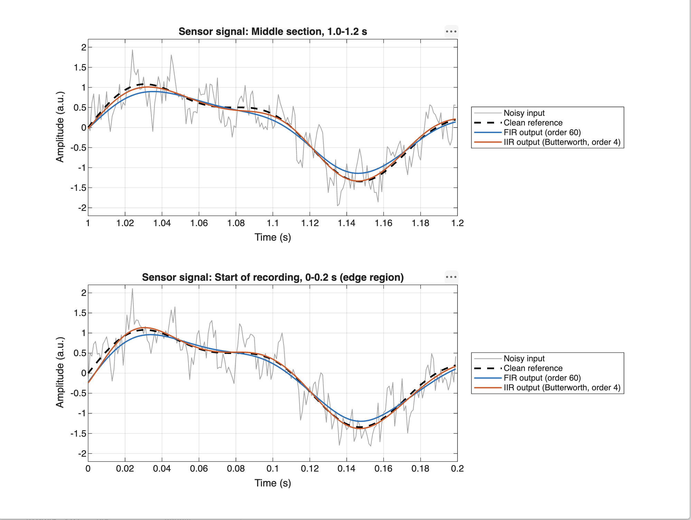
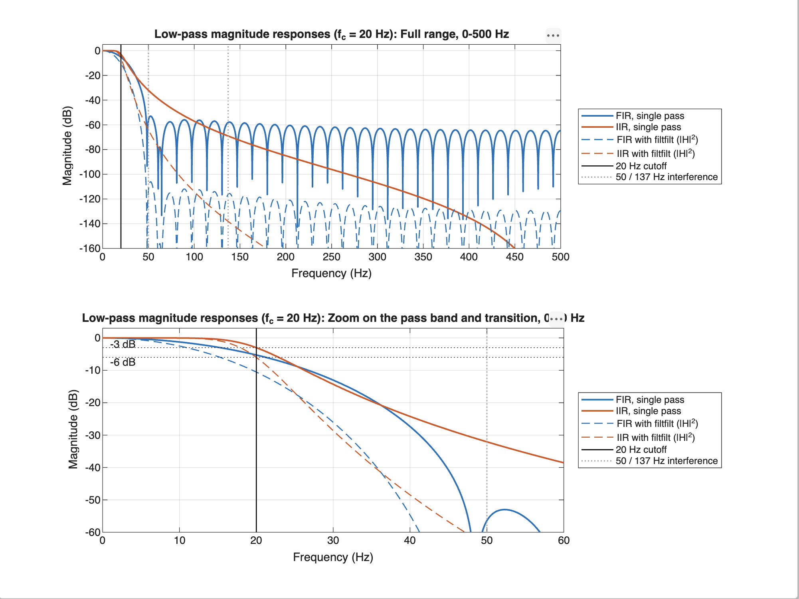
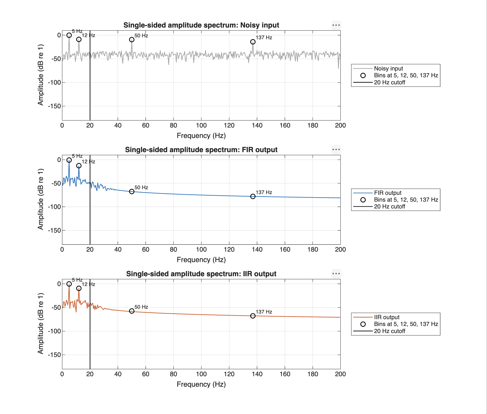
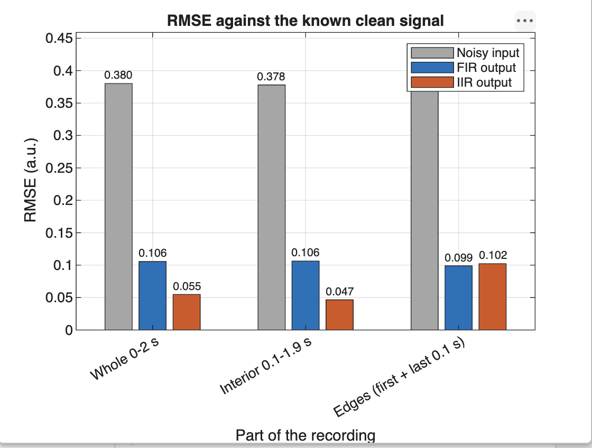
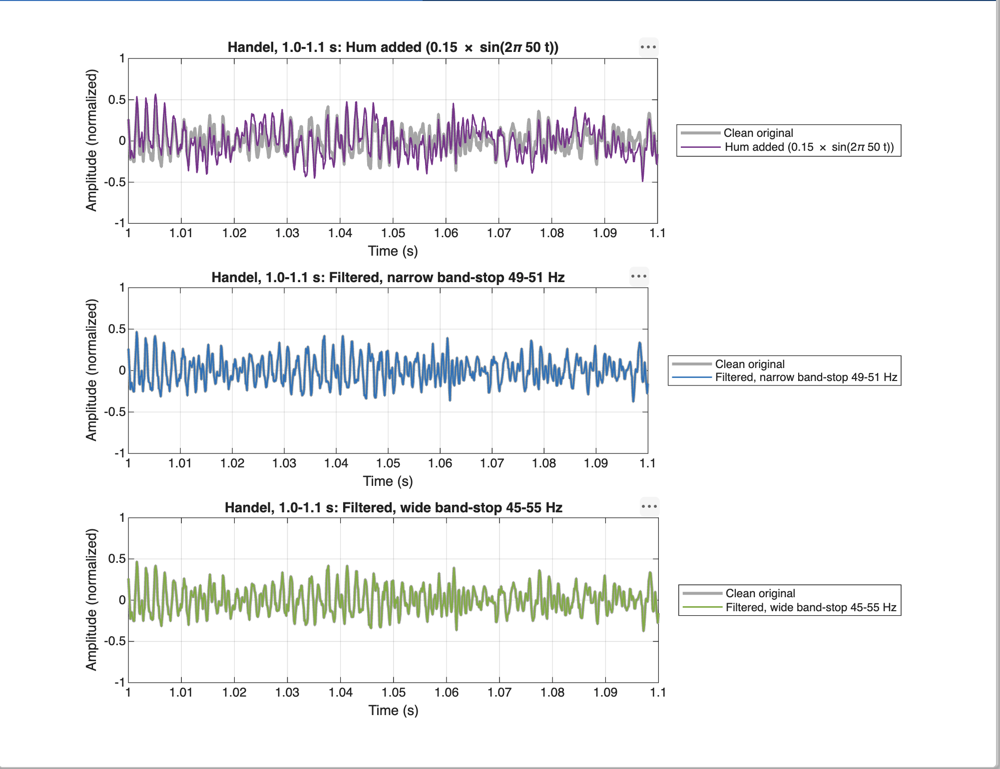
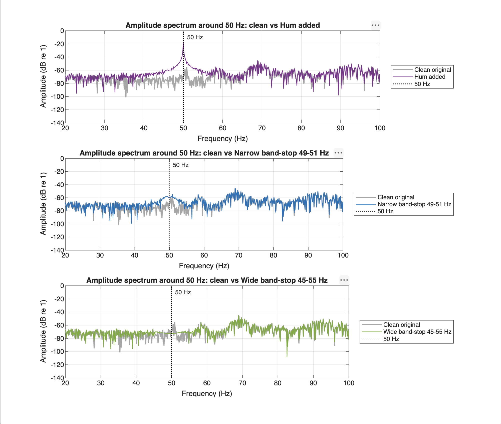
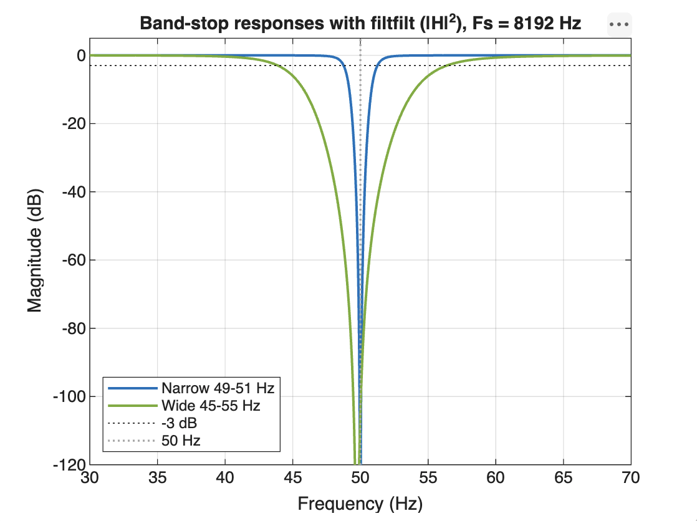

# Lecture 06: Digital Filter Design

This report covers the design, application and evaluation of digital filters on two kinds of data:

- **Part A:** a synthetic sensor signal with a known clean reference. A 20 Hz low-pass FIR filter and a 20 Hz low-pass IIR filter are compared.
- **Part B:** the Handel audio recording with an added 50 Hz hum, removed with a narrow and a wide band-stop filter.

All measured values in this report are copied from [`results.txt`](results.txt), produced by running the script in MATLAB Online (R2026b).

---

## Files and Environment

- [`Lecture06_digital_filters.m`](Lecture06_digital_filters.m): one runnable script for Parts A and B. It has no local functions, so it also runs section by section.
- `results.txt`: everything the script prints (RMSE tables, gains, 50 Hz measurements).
- `figures/`:
  - `partA1_time_domain.png`
  - `partA2_frequency_response.png`
  - `partA3_spectra.png`
  - `partA4_rmse.png`
  - `partB1_waveform.png`
  - `partB2_spectrum.png`
  - `partB3_notch_response.png`

| Item | Value |
| :--- | :--- |
| MATLAB version | 26.2.0.3433840 (R2026b) Update 1, MATLAB Online |
| Signal Processing Toolbox | version 26.2, license available (required for `fir1`, `butter`, `freqz`, `filtfilt`, `grpdelay`) |

```bash
cd Lecture06 && matlab -batch "run('Lecture06_digital_filters.m')"
```

At the end, the script plays the clean, hum-added and filtered audio at one common gain. It also writes the same four signals to `audio/*.wav`, so you can listen on another device if playback does not work in MATLAB, for example in MATLAB Online. `audio/` is git-ignored and is not part of the submission. The flags `playAudio` and `saveAudio` turn each option off.

---

## Part A: Filter a Sensor Signal

### Setup

$$x(t) = \underbrace{\sin(2\pi\,5t) + 0.35\sin(2\pi\,12t)}_{\text{clean (wanted)}} + \underbrace{0.35\sin(2\pi\,50t) + 0.20\sin(2\pi\,137t) + 0.25\,n(t)}_{\text{interference + noise}}$$

The signal is 2 s long, sampled at $F_s = 1000$ Hz with `rng(7)`, where $n(t)$ is white Gaussian noise. Both filters have a 20 Hz cut-off ($W_n = 20/500 = 0.04$) and are applied with `filtfilt`.

| | FIR | IIR |
| :--- | :--- | :--- |
| Design | `fir1(60, 0.04)`, Hamming window | `butter(4, 0.04)` |
| Order | 60 | 4 |
| Coefficients | 61 ($b$), $a = 1$ | 5 ($b$) + 5 ($a$) = 10 |
| Meaning of "20 Hz" | −6 dB point of the window design (−5.3 dB measured) | exact −3 dB point |
| Single-pass delay | constant 30 samples = 30 ms (linear phase) | 21 ms at 5 Hz, 26 ms at 12 Hz (varies with frequency) |

**Why `filtfilt` changes the response.** `filtfilt` runs the filter forward and then backward. The phase cancels, so the delay becomes zero, but the magnitude is applied twice: $|H_{\text{ff}}| = |H|^2$, which is twice the dB value. Both the single-pass and `filtfilt` curves are shown below.

### A1: Time-domain comparison


The **top panel (1.0–1.2 s)** is away from the edges. Both outputs remove the fast 50 Hz and 137 Hz ripple and the sample-to-sample noise. The IIR output (orange) follows the clean signal (black dashed) closely. The FIR output (blue) has the right shape and timing but **smaller peaks**, because it also weakens the wanted 12 Hz component (see A2). Neither output is shifted in time, because `filtfilt` gives zero phase.

The **bottom panel (0–0.2 s)** shows the start of the recording. `filtfilt` pads the ends by reflecting the signal, so there is no large start-up transient, but the first few samples are still off. At $t = 0$ both outputs start at about −0.2 instead of 0. The IIR output also overshoots the first peak (about 1.13 against 1.08 for the clean signal) before it settles onto the clean curve after about 0.05 s. A4 confirms this: the IIR's error near the edges is about twice its error in the middle (0.102 vs 0.047). The FIR's edge error (0.099) is no larger than its interior error (0.106), because its main error, the weakened 12 Hz component, is present everywhere.

### A2: Magnitude responses (`freqz`)


The vertical black line marks the 20 Hz cut-off. The dotted gray lines mark the 50 Hz and 137 Hz interference.

| Frequency | FIR, single pass | FIR, `filtfilt` | IIR, single pass | IIR, `filtfilt` |
| :---: | :---: | :---: | :---: | :---: |
| 5 Hz (wanted) | −0.31 dB | −0.62 dB (×0.93) | −0.00 dB | −0.00 dB (×1.00) |
| 12 Hz (wanted) | −1.81 dB | **−3.63 dB (×0.66)** | −0.07 dB | −0.14 dB (×0.98) |
| 20 Hz (cut-off) | −5.27 dB | −10.5 dB | −3.01 dB | −6.02 dB |
| 50 Hz (interference) | −56.4 dB | **−113 dB** | −32.1 dB | −64.2 dB |
| 137 Hz (interference) | −58.1 dB | −116 dB | −69.1 dB | −138 dB |

| Transition | FIR | IIR |
| :--- | :---: | :---: |
| −3 dB point | 15.4 Hz | 20.0 Hz |
| −20 dB point | 35.7 Hz | 35.5 Hz |
| −40 dB point | 44.8 Hz | 62.6 Hz |
| Stop band | sidelobes ≤ −56 dB above 60 Hz | keeps falling, −24 dB per octave |

The 61-tap FIR has a **wide transition band**. A Hamming window gives a transition of about $3.3\,F_s/L = 3.3 \cdot 1000/61 \approx 54$ Hz, spread around the cut-off. So the FIR is already rolling off at 12 Hz, and it reaches a deep stop band by about 45 Hz. The Butterworth is flat up to about 15 Hz and then falls smoothly. It attenuates 50 Hz less than the FIR, but still by 64 dB with `filtfilt`.

### A3: Single-sided amplitude spectra


$N = 2000$, so $\Delta f = F_s/N = 0.5$ Hz. All four frequencies fall exactly on a bin, so these tones show no leakage. The y-axis is in dB because the interference drops by more than 60 dB.

| Frequency | Clean | Noisy | FIR output | IIR output |
| :---: | :---: | :---: | :---: | :---: |
| 5 Hz | 1.000 | 0.999 | 0.930 | 0.999 |
| 12 Hz | 0.350 | 0.350 | **0.230** | 0.343 |
| 50 Hz | 0 | 0.346 | 4.2 × 10⁻⁴ (−58 dB) | 1.4 × 10⁻³ (−48 dB) |
| 137 Hz | 0 | 0.205 | 1.3 × 10⁻⁴ (−64 dB) | 4.2 × 10⁻⁴ (−54 dB) |

The dB values are relative to the noisy input at the same frequency. The 5 Hz and 12 Hz results match the input amplitude × the `filtfilt` gain from A2 almost exactly: 0.93 and 0.23 for the FIR, 1.00 and 0.34 for the IIR.

- **5 Hz:** kept by both filters. The FIR loses about 7%; the IIR is unchanged.
- **12 Hz:** the IIR keeps it at about 98%. The FIR cuts it to about 66% of its amplitude, which is the main weakness of the FIR design.
- **50 Hz:** removed by both, from 0.346 to below 0.0015. The measured reduction (−58 dB FIR, −48 dB IIR) is **smaller** than `freqz` predicts (−113 dB, −64 dB). What remains at 50 Hz is most likely not the 50 Hz tone. It is the broadband content of the short transients at the start and end of the output, which the steady-state frequency response does not describe. That fits the IIR having both the higher 50 Hz floor and the larger edge error in A4. Either way the interference is about 250× (IIR) to 800× (FIR) smaller than before.
- **137 Hz:** removed by both in the same way, from 0.205 to below 0.0005.
- **Between the tones:** the broadband noise floor above about 30 Hz disappears in both outputs. The noise **below 20 Hz stays**, because a low-pass filter cannot separate noise that shares the signal's band.

### A4: RMSE against the clean signal


$$\text{RMSE} = \sqrt{\frac{1}{N}\sum_{n}\big(y[n] - \text{clean}[n]\big)^2}$$

| Signal | Whole 0–2 s | Interior 0.1–1.9 s | Edges (first + last 0.1 s) |
| :--- | :---: | :---: | :---: |
| Noisy input | 0.380 | 0.378 | 0.399 |
| FIR output | 0.106 | 0.106 | 0.099 |
| IIR output | **0.055** | **0.047** | 0.102 |

Filtering reduces the error 3.6× with the FIR and 6.9× with the IIR. These values match what the filter responses predict (noisy ≈ 0.38, FIR ≈ 0.10, IIR ≈ 0.05):

- **The FIR error is mostly distortion of the wanted signal.** Losing 34% of the 12 Hz amplitude and 7% of the 5 Hz amplitude accounts for about 0.097 of its 0.106. Its error is the same at the edges and in the middle.
- **In the middle, the IIR error is mostly noise.** Its 0.047 is about the noise left below 20 Hz, which no low-pass filter can remove.
- **At the edges, the IIR error doubles to 0.102.** The Butterworth's impulse response lasts about 100 ms, because its slowest poles decay with a time constant of about 21 ms. But `filtfilt` pads each end with only $3 	imes 4 = 12$ reflected samples, so the start-up transient spills into the output. For the FIR, `filtfilt` pads with $3 	imes 60 = 180$ samples, longer than its 61-sample impulse response, so the transient stays in the padding.

**What RMSE tells you:** how far the output is from the reference on average, in signal units, as one number for comparing designs. Both filters reduce the error several times, and the IIR output is closer to the clean signal.

**What RMSE cannot tell you:**
- **Why** there is an error. A gain loss at 12 Hz, a time shift, leftover 50 Hz and edge transients all look the same in one number.
- **Where** the error is in time or frequency. That is why the table also splits edges from the interior, and why the spectra are needed.
- **What the application needs.** A small phase shift could raise RMSE a lot but not matter for a level measurement, while a short spike could matter a lot but barely move RMSE.
- It needs a **clean reference**, which only exists in a simulation like this one.

### A5: Design comparison

| Criterion | FIR (order 60) | IIR (Butterworth, order 4) |
| :--- | :--- | :--- |
| Coefficients / order | 61 coefficients, order 60 | 10 coefficients, order 4 |
| Transition | wide: −3 dB at 15.4 Hz, −40 dB at 44.8 Hz | flat to about 15 Hz, −3 dB at 20 Hz, then −24 dB/octave |
| Wanted 12 Hz (`filtfilt`) | −3.6 dB (34% amplitude loss) | −0.14 dB (2% loss) |
| 50 Hz / 137 Hz (`filtfilt`) | −113 dB / −116 dB | −64 dB / −138 dB |
| Phase (single pass) | linear, constant 30 ms delay | non-linear, 21–26 ms in the pass band |
| Stability | always stable (no feedback) | stable here, but sensitive to coefficient rounding at very low cut-offs |
| Edge effects (RMSE, first + last 0.1 s) | 0.099, no worse than the middle (0.106) | 0.102, about 2× the middle (0.047) |

**Edge effects.** `filtfilt` reflects $3\times$(filter order) samples at each end before filtering. That is enough padding for the FIR (180 samples), but not for the slowly decaying IIR (12 samples), so only the IIR shows a visible edge error. If the edges matter, trim the first and last 0.1 s, or pad the signal yourself before filtering.

**When I would prefer each design:**
- **FIR:** when the waveform shape matters in a **causal (live)** system, for example ECG or vibration analysis that compares the timing of features. The constant delay keeps every frequency aligned, and the filter is always stable. It needs more taps than used here, about 200 for a 20 Hz cut-off at 1000 Hz with the 12 Hz component kept within 0.1 dB.
- **IIR:** when computing power or latency is limited, for example a battery-powered sensor or a microcontroller. Four poles give a sharp, flat response with 10 coefficients, and the delay is shorter than a comparable FIR.

---

## Part B: Reduce a 50 Hz Hum in Audio

### Setup

```matlab
handel = load('handel');           % y and Fs, same as "load handel"
xClean = handel.y(:);              % Fs = 8192 Hz
xHum   = xClean + 0.15*sin(2*pi*50*tAudio);
[bN,aN] = butter(2, [49 51]/(FsA/2), 'stop');   % narrow
[bW,aW] = butter(2, [45 55]/(FsA/2), 'stop');   % wide, for comparison
yAudio  = filtfilt(bN, aN, xHum);
```

$F_s = 8192$ Hz $> 102$ Hz. The normalized stop-band edges are $[49, 51]/4096 \approx [0.0120, 0.0125]$ and $[45, 55]/4096 \approx [0.0110, 0.0134]$, all below 1. `butter(2, …, 'stop')` gives a 4th-order band-stop: two poles per edge.

### B1: Waveform before and after


Every panel uses the same section (1.0–1.1 s) and the same y-axis, with the clean original in thick gray. With hum added (purple), the curve no longer follows the clean one. It is pushed above and below it by up to 0.15, and the offset repeats every 20 ms, the period of 50 Hz. The music itself is fast compared with 50 Hz, so the hum shows as this slow offset rather than as a visible sine wave. After the narrow band-stop (blue), the curve lies on top of the clean original again. The wide band-stop (green) also removes the hum, and its curve is just as close at this scale. In the time domain the two filters cannot be told apart.

### B2: Spectrum around 50 Hz


Each panel overlays one signal on the clean spectrum (gray).

- **Hum added:** a sharp peak at 50 Hz reaching about −18 dB, roughly 50 dB above the music near 50 Hz (−70 to −80 dB). Its skirts raise the floor from about 35 to 58 Hz.
- **Narrow 49–51 Hz:** the peak is gone, and above 52 Hz and below 45 Hz the curve lies on the clean one. Between about 45 and 52 Hz a **small bump of about −57 dB** remains, 10–20 dB above the clean spectrum. This is the leftover hum at the start and end of the clip, where the narrow notch rings for a long time (see B4: −69 dB in the interior but only −43 dB over the whole clip).
- **Wide 45–55 Hz:** the peak is gone, with no bump left. But between about 45 and 56 Hz the music's own detail is also gone. The clean spectrum's peaks there (up to about −55 dB near 51 Hz) are replaced by a **smooth, flat floor at about −72 dB**. This is the music the wide filter removes.

### B3: Notch filter responses (optional figure)


| | Narrow 49–51 Hz | Wide 45–55 Hz |
| :--- | :---: | :---: |
| −3 dB stop band, single pass | 49.0–51.0 Hz | 45.0–55.0 Hz |
| −3 dB stop band with `filtfilt` | 48.8–51.3 Hz | 43.9–56.4 Hz |
| Attenuation at 50 Hz with `filtfilt` | about −160 dB (centre at 49.99 Hz) | about −104 dB |
| Loss at 45 Hz / 55 Hz with `filtfilt` | −0.01 dB | −6.0 dB |
| Loss at 40 Hz / 60 Hz with `filtfilt` | −0.00 dB | −0.4 dB / −0.7 dB |

### B4: 50 Hz amplitude before and after

**Method.** The 50 Hz amplitude is measured by projecting the signal onto a 50 Hz complex exponential:

$$A_{50} = \frac{2}{N}\left|\sum_n x[n]\,e^{-j2\pi\,50\,n/F_s}\right|$$

This is a DFT evaluated at exactly 50 Hz. It avoids the problem that 50 Hz does not fall on an FFT bin for this length ($\Delta f = 8192/73113 \approx 0.112$ Hz). It is computed over the whole signal and over the interior (1 s removed from each end), to separate steady-state attenuation from edge effects. The value is cross-checked against the attenuation from `freqz`.

| Signal | $A_{50}$, whole | $A_{50}$, interior |
| :--- | :---: | :---: |
| Clean original | 0.00038 | 0.00034 |
| Hum added | 0.15020 | 0.15022 |
| Narrow band-stop | 0.00103 (−43.3 dB) | 0.00005 (**−69.4 dB**) |
| Wide band-stop | 0.00024 (−55.9 dB) | 0.00002 (**−77.7 dB**) |

The dB values are relative to the hum-added signal. The hum measures 0.150, the amplitude that was added, so the method works.

- **Steady state (interior):** the narrow filter cuts the 50 Hz amplitude by 69 dB, about 3000×, and the wide one by 78 dB. Both end below the music's own 50 Hz content (0.00034), because the filter removes that too.
- **Compared with `freqz`:** the filter response predicts −160 dB (narrow) and −104 dB (wide) with `filtfilt`. The measured values are smaller because the filter has not fully settled. The narrow notch rings longest, so some ringing is still present after the first second. Small music components just next to 50 Hz also leak into the single-frequency measurement.
- **Whole signal:** the reduction drops to −43 dB (narrow) and −56 dB (wide). Most of the remaining hum is in the start-up and end transients, where the notch has not yet settled. The narrow notch settles more slowly, so it is affected more (see the edge row below).

### B5: Listening test (same playback gain)

All four versions use one common gain, `0.9 / max(|all signals|)`. `soundsc` was not used, because it scales each signal separately and would hide level differences. The same scaled signals are saved as WAV files (`1_clean`, `2_hum_added`, `3_narrow_49_51Hz`, `4_wide_45_55Hz`), so the comparison keeps the same gain when played outside MATLAB. Use headphones: many laptop speakers barely reproduce 50 Hz, so the hum can be inaudible even when it is there.

> TBD after listening: describe whether the hum is audible in the hum-added version, whether it is gone after the narrow filter, and whether the music sounds different. Expected result: the 50 Hz hum is heard as a low drone under the choir. The narrow filter removes it without an audible change, because Handel has very little content within ±1 Hz of 50 Hz. The wide filter also sounds clean on most playback systems, because laptop speakers reproduce little at 45–55 Hz.

### Narrow vs wide stop band

| | Narrow 49–51 Hz | Wide 45–55 Hz |
| :--- | :---: | :---: |
| Music removed: RMS of (filtered clean − clean) | 0.00144 (−42.7 dB re music) | 0.00227 (−38.7 dB re music) |
| RMSE vs clean after filtering hum-added audio (before: 0.106) | 0.00526 | **0.00332** |
| Error RMS in first + last 0.5 s | 0.0151 | 0.0079 |
| Error RMS in the rest (steady state) | **0.0015** | 0.0022 |

The music RMS is 0.196. Both filters cut the error against the clean recording by a factor of 20–30, from 0.106 to about 0.005.

- **In the steady part, the narrow filter is better** (0.0015 vs 0.0022), because it removes less music. The wide filter removes 1.6× more of the clean music (0.00227 vs 0.00144).
- **Over the whole clip, the wide filter has the lower RMSE** (0.0033 vs 0.0053). This is only because of the edges, where the narrow filter's error (0.0151) is twice the wide filter's (0.0079).

The music loss is small for both filters, because Handel (a choir, sampled at 8192 Hz) has very little energy near 50 Hz. With bass-heavy music the wide filter would remove much more.

A **wider band** removes more of the frequency range around 50 Hz. That helps if the hum is not exactly 50 Hz, because mains frequency can drift by about ±0.2 Hz, and if it varies in amplitude, which spreads its energy into side frequencies. The cost is that **every** component between about 44 and 56 Hz is cut, including bass notes, the low end of male voices, and drum and organ fundamentals that happen to sit there. The wide filter also attenuates by about 0.4–0.7 dB as far away as 40 and 60 Hz.

There is also a **time-domain trade-off**. A band-stop of width $B$ rings for about $1/(\pi B)$ seconds: about 0.16 s for the 2 Hz band and about 0.03 s for the 10 Hz band. The narrow filter is therefore more selective in frequency, but it takes longer to settle at the start and end of the recording and after any sudden change in the hum. The measurements confirm this: the narrow filter's edge error is twice the wide filter's, and its whole-signal hum reduction is 13 dB worse.

---

## Report Questions

### 1. Why is a 20 Hz low-pass reasonable for Part A, and what does it assume?
> **Answer:** **The cut-off sits in the gap between the highest wanted component (12 Hz) and the lowest interference (50 Hz). It assumes the wanted sensor signal has no useful content above about 15–20 Hz.**
>
> 20 Hz leaves a margin above 12 Hz, so a well-designed filter passes the measurement almost unchanged. It is also 2.5× below 50 Hz, so the filter has a full transition range to reach strong attenuation before the interference.
>
> The assumption is that the measured quantity changes slowly. Faster events such as steps, spikes or short transients have content above 20 Hz, so the filter would round them off and delay them. The filter also removes nothing inside 0–20 Hz, so noise in that band stays.

### 2. Which filter gives the better result for these requirements?
> **Answer:** **The 4th-order Butterworth IIR, for the requirement "keep the 5 Hz and 12 Hz components unchanged and remove 50 Hz, 137 Hz and the noise".**
>
> 1. **Frequency response (`freqz`):** with `filtfilt`, the IIR passes 12 Hz at −0.14 dB, while the FIR cuts it by −3.6 dB (34% amplitude loss). Both put 50 Hz and 137 Hz more than 60 dB down.
> 2. **Spectra:** the 12 Hz peak is 0.343 in the IIR output and only 0.230 in the FIR output, against 0.350 in the clean signal. At 5 Hz: 0.999 vs 0.930.
> 3. **RMSE:** IIR 0.055 vs FIR 0.106 over the whole signal, and 0.047 vs 0.106 in the interior. The IIR output is about twice as close to the clean signal.
> 4. **Time plot:** the IIR output overlaps the clean curve, while the FIR output has visibly smaller peaks.
>
> The FIR does attenuate 50 Hz more (−113 dB vs −64 dB). But both values leave the interference far below the remaining noise, so this advantage does not improve the result.
>
> The IIR's one weakness is the edges: in the first and last 0.1 s its error (0.102) is as large as the FIR's (0.099). If the edges matter, trim them or pad the signal before filtering. With about 200 taps the FIR would match the IIR in the pass band, at a much higher computational cost.

### 3. How would the implementation change for live, low-latency filtering?
> **Answer:** **`filtfilt` cannot be used, because it needs the whole recording and runs backwards in time. The filter must be causal, using `filter` sample by sample or block by block with its state kept between blocks. The delay must then be accepted and kept small.**
>
> - A single causal pass gives the **single-pass** response. The IIR then attenuates 50 Hz by only 32 dB instead of 64 dB. That is still a residual of about 0.009, which is below the noise. The FIR gives −56 dB.
> - **Latency:** the 61-tap FIR delays every frequency by 30 ms. The IIR delays by 21–26 ms in the pass band, so it has lower latency but **non-linear phase**: the 12 Hz component is delayed about 4 ms more than the 5 Hz component, which slightly changes the waveform shape. If shape matters, use a linear-phase FIR and accept its delay. If low latency matters most, use the IIR.
> - A longer FIR that fixes the 12 Hz loss (about 200 taps) would delay by about 100 ms, which may be too much for a control loop. A low-order IIR is then the practical choice.
> - On real hardware, implement the IIR as **second-order sections** (`[sos,g] = butter(4, Wn)` and `sosfilt`) to avoid rounding problems, and initialize the filter state to avoid a start-up transient.

### 4. Why is a narrow band-stop right for a steady 50 Hz hum, and what if it drifts?
> **Answer:** **A steady hum is a single known frequency, so a narrow notch removes it while leaving almost all of the useful audio. If the frequency drifts, the notch has to follow it, or the stop band must be widened at the cost of more music.**
>
> All the hum energy sits in one spectral line, so only a band of about ±1 Hz needs removing. The narrow filter loses less than 0.03 dB at 46 Hz and 54 Hz, so the music is effectively untouched.
>
> If the hum frequency drifted, I would:
> - **Track it:** estimate the hum frequency continuously (spectral peak or phase-locked loop) and retune a notch such as `iirnotch`.
> - **Use adaptive cancellation:** an LMS filter driven by a mains reference signal.
> - **Widen the stop band** only as far as the drift requires, accepting the loss of nearby content.
>
> Real mains hum also has **harmonics** (100, 150, 200 Hz …), so a comb filter or several notches would usually be needed.

### 5. One limitation and one improvement
> **Answer:** **Limitation: everything is synthetic and ideal. The clean signal is known exactly, the interference is perfectly steady at exact frequencies, there is a single noise realization (`rng(7)`), and the processing is offline with `filtfilt`.** Even in this ideal case, the edge transients set the limit: the hum reduction dropped from −69 dB in the steady part to −43 dB over the whole clip.
>
> In a real measurement system no clean reference exists, so RMSE cannot be computed. Real interference drifts and has harmonics, and the filtering must be causal. The numbers here, for example a 64 dB hum reduction, are therefore best-case values.
>
> **Improvement:** evaluate the filters as they would really run. Use causal second-order-section filters and test with a drifting hum frequency, hum harmonics and many random noise seeds, reporting the mean and spread of the error. Measure quality without a reference, for example the residual power at 50 Hz and its harmonics, or SNR in the signal band. Add a proper analog anti-aliasing filter before sampling. On the hardware side, reduce hum at its source with shielding, twisted-pair cabling, avoiding ground loops and differential inputs, so the digital filter has less to remove.

---

## Use of AI Tools

I used an AI assistant (Claude Code) to help write the MATLAB script and to draft the explanations in this report. The filter-response values were checked independently against the filter formulas. I ran the script myself in MATLAB, filled in the measured values from `results.txt`, and reviewed the explanations against my own plots and listening test.
