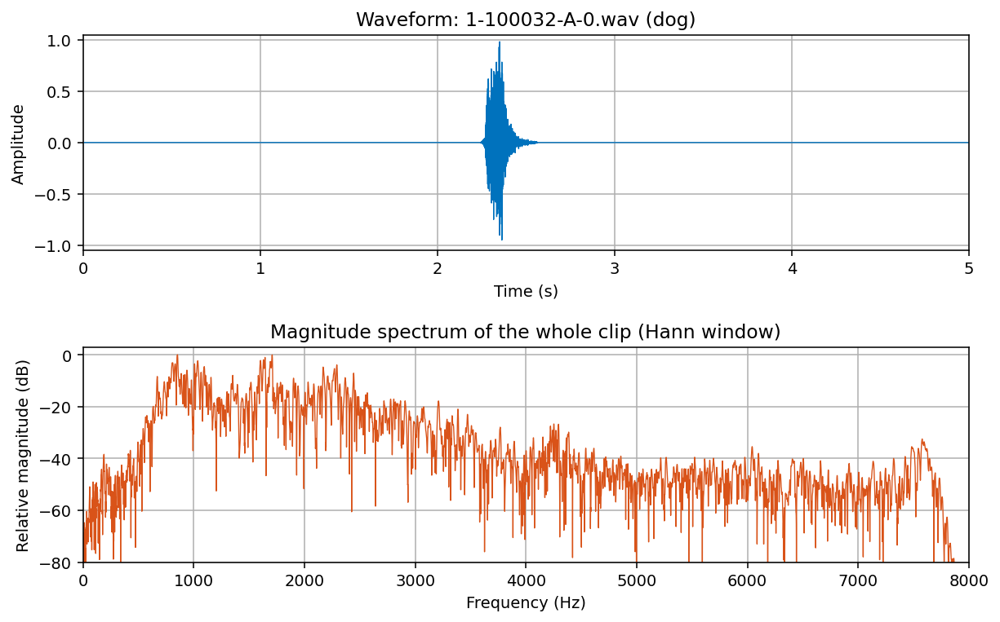
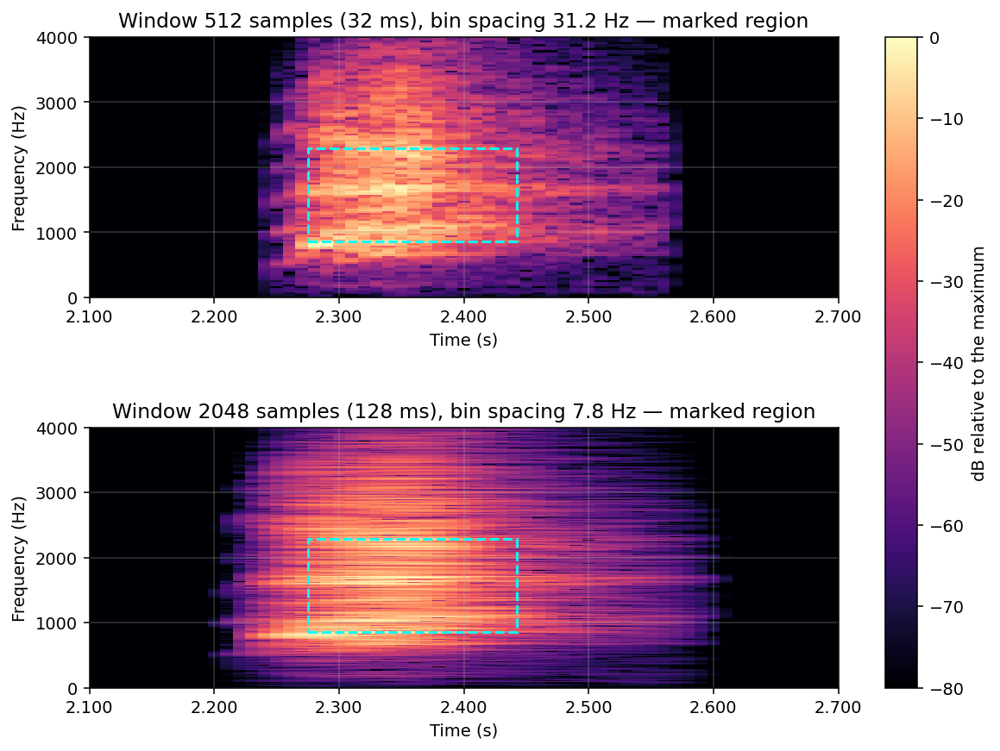

# Lecture 07: Audio Signal Processing and AI for Audio

**Selected option: C — Analyse an environmental sound.**

One supplied ESC-50 dog recording is loaded at 16 kHz, inspected as a waveform and a spectrum, and compared in two spectrograms that differ only in window length (512 and 2048 samples, both with a 160-sample hop). The bark is then located in time and frequency.

---

## Files

- [`analysis.ipynb`](analysis.ipynb): the executed notebook with all outputs and written explanations.
- [`data/1-100032-A-0.wav`](data/1-100032-A-0.wav): the analysed recording, the only audio file included (see [Audio source](#audio-source-and-attribution)).
- `results/`: figures and result tables written by the notebook:
  - [`01_waveform_spectrum.png`](results/01_waveform_spectrum.png): waveform and magnitude spectrum of the whole clip
  - [`02_spectrograms_full.png`](results/02_spectrograms_full.png): 512 and 2048-sample spectrograms, full clip
  - [`03_spectrograms_bark_zoom.png`](results/03_spectrograms_bark_zoom.png): the same spectrograms, zoomed on the bark
  - [`04_event_region.png`](results/04_event_region.png): the selected time interval and frequency region
  - [`window_comparison.csv`](results/window_comparison.csv): measured time spread and spectral detail per window
  - [`event_region.csv`](results/event_region.csv): the selected interval and band

## Audio file and settings

| Setting | Value |
|---|---|
| Recording | `1-100032-A-0.wav` (class `dog`, ESC-50 fold 1) |
| Original format | 44.1 kHz, mono, 16-bit PCM, 5.0 s |
| Analysis sample rate | 16 kHz (`librosa.resample`) |
| STFT windows | Hann, 512 samples (32 ms) and 2048 samples (128 ms) |
| Hop length | 160 samples (10 ms) for both |
| Frequency bin spacing | 31.25 Hz (512) and 7.81 Hz (2048) |
| Event threshold | −20 dB relative to the loudest frame |

## How to run the notebook

The notebook needs Python 3.10–3.12 and runs on the CPU. It reads `data/1-100032-A-0.wav` and writes to `results/`, both relative to the notebook, so start Jupyter from this folder:

```bash
cd Lecture07_Audio_Signal_Processing_and_AI
python3 -m venv .venv && source .venv/bin/activate
pip install numpy==2.1.3 scipy==1.15.3 matplotlib==3.10.1 pandas==2.2.3 librosa==0.11.0 soundfile==0.13.1 jupyter
jupyter nbconvert --to notebook --execute --inplace analysis.ipynb   # or open it with: jupyter lab
```

In Google Colab, upload `analysis.ipynb`, create a `data/` folder, upload the WAV file into it and choose **Run all**. These package versions match the lecture notebook's pinned environment.

## Results



The clip contains one bark a little after 2 s. The rest is digital silence (about 92 % of the samples are exactly zero). The whole-clip spectrum has no single dominant tone. Its energy sits in a band of peaks between about 0.7 and 2.5 kHz, and 99 % of it lies below 2.9 kHz.



| Window | Bin spacing | Event span above −20 dB | Duration | Peaks above −20 dB, 0.5–3 kHz |
|---|---|---|---|---|
| 512 (32 ms) | 31.25 Hz | 2.27–2.43 s | 0.16 s | 15 |
| 2048 (128 ms) | 7.81 Hz | 2.24–2.45 s | 0.21 s | 63 |

**Selected region:** the bark lasts from **2.28 s to 2.44 s** (0.17 s), and 80 % of its energy is between **0.85 and 2.3 kHz**. The strongest peak is at 854 Hz.

## Main conclusion

**The 512-sample window is the better view for this short bark, and the 2048-sample window is better for separating nearby frequencies.**

- With 512 samples, the bark has sharp start and end edges and an apparent duration (0.16 s) close to the envelope measurement (0.17 s), but its spectral peaks merge into broad bands.
- With 2048 samples, the separate peaks near 0.85, 1.6 and 2.2 kHz show as distinct horizontal lines. However, each frame spans 128 ms, so the bark is smeared in time: it appears about 30 ms earlier and lasts 0.21 s, with a soft onset.
- The hop is the same for both, so the difference comes from the window length alone. This is the STFT time–frequency trade-off.

## Limitation

**One clip from one dog in silence cannot describe dog barks in general.** The clip is mostly zero padding, so there is no real background, and the analysis says nothing about how the bark looks in noise. The 0.85–2.3 kHz band also does not, on its own, identify a dog: other sounds can occupy the same band. The event boundaries depend on the chosen −20 dB threshold.

Converting to 16 kHz discards content above 8 kHz. For this file that is only 0.14 % of the energy, but it would matter for sounds with strong high-frequency content, such as rain or crackling fire.

## Audio source and attribution

`1-100032-A-0.wav` is from the [ESC-50 dataset](https://github.com/karolpiczak/ESC-50) (K. J. Piczak, *ESC: Dataset for Environmental Sound Classification*). It is a clip derived from [*rose_bark.wav*](http://www.freesound.org/people/nfrae/sounds/100032/) by **nfrae** on Freesound, licensed **CC0**. The ESC-50 dataset as a whole is licensed under [CC BY-NC 3.0](http://creativecommons.org/licenses/by-nc/3.0/). The course's ESC-50 subset and per-recording attributions come from the lecture's student package, which is not included in this repository.
