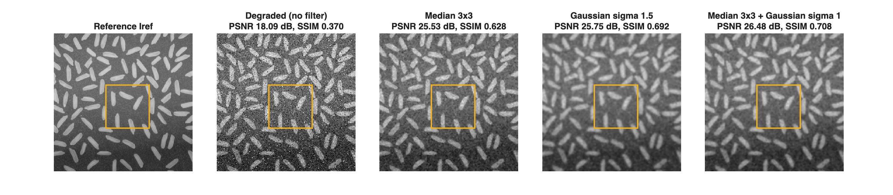
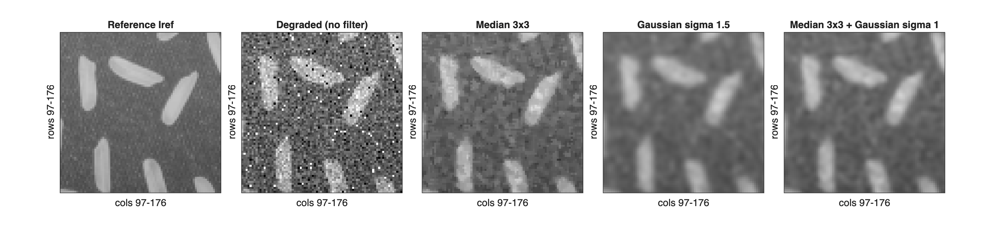
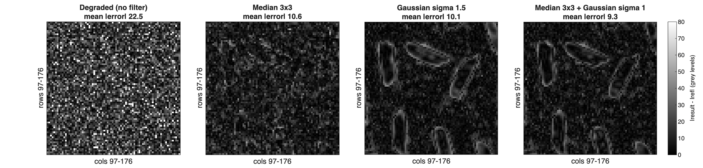

# Lecture 08: Image Processing

**Selected option: A — Compare denoising filters.**

The reference image `rice.png` is degraded with Gaussian noise and salt-and-pepper impulses. Three filters are applied to the degraded image and each result is compared with the reference using PSNR and SSIM.

---

## Files

- `analysis.mlx`: the executed MATLAB Live Script with outputs and written explanations.
- `analysis.pdf`: a PDF export of the executed Live Script, readable on GitHub without MATLAB.
- [`analysis.m`](analysis.m): the plain-text source of the Live Script.
- `results/`:
  - `median3x3.png`, `gaussian_sigma1p5.png`, `median3x3_gaussian_sigma1.png`: the three processed images
  - `metrics.csv`: PSNR and SSIM of each result against `Iref`
  - `fig1_full_images.png`: reference, degraded and filtered images with the zoom region marked
  - `fig2_zoom_80x80.png`: the 80×80-pixel zoomed region for all results
  - `fig3_error_maps.png`: absolute error against `Iref` in the zoomed region

The supplied image is not included. `rice.png` ships with the Image Processing Toolbox.

## Image and settings

| Item | Value |
|---|---|
| Reference image `Iref` | `rice.png` (256×256, `uint8`, Image Processing Toolbox sample image) |
| Degradation | `rng(42); Id = imnoise(imnoise(Iref,'gaussian',0,0.01),'salt & pepper',0.02);` |
| Filter 1 | `medfilt2(Id,[3 3],'symmetric')` |
| Filter 2 | `imgaussfilt(Id,1.5)` (default 7×7 kernel, replicate padding) |
| Filter 3 | `imgaussfilt(medfilt2(Id,[3 3],'symmetric'),1)` |
| Metrics | `psnr(result,Iref)`, `ssim(result,Iref)` |
| Zoomed region | rows 97–176, columns 97–176 (80×80 pixels) |
| MATLAB version | 26.2.0.3468271 (R2026b) Update 2, Image Processing Toolbox 26.2 |

`medfilt2` pads with zeros by default. That darkens the one-pixel image border and would lower PSNR for a reason unrelated to denoising, so both median filters use `'symmetric'` padding. All other settings are the defaults.

## How to run the Live Script

1. Open MATLAB (desktop or MATLAB Online) with the Image Processing Toolbox and change the current folder to `Lecture08_Image_Processing`.
2. In the Current Folder browser, right-click `analysis.m` and choose **Open as Live Script**. Save it as `analysis.mlx`.
3. Click **Run** in the Live Editor. The outputs appear inline and the files in `results/` are written.
4. Choose **Live Editor → Save → Export to PDF** and save as `analysis.pdf`.

The plain script also runs without the Live Editor:

```bash
cd Lecture08_Image_Processing && matlab -batch "run('analysis.m')"
```

## Results

All values are copied from [`results/metrics.csv`](results/metrics.csv). Mean |error| is the mean absolute difference from `Iref` over the whole image, in grey levels, as printed in the error-map titles.

| Method | PSNR (dB) | SSIM | Mean \|error\| |
|---|---|---|---|
| Degraded (no filter) | 18.09 | 0.3696 | 22.5 |
| Median 3×3 | 25.53 | 0.6276 | 10.6 |
| Gaussian σ = 1.5 | 25.75 | 0.6921 | 10.1 |
| **Median 3×3 + Gaussian σ = 1** | **26.48** | **0.7083** | **9.3** |







## Main conclusion

**I prefer the 3×3 median followed by a Gaussian filter with σ = 1. It is the best on both metrics (26.48 dB, SSIM 0.708) and is the only one of the three that handles both noise types.**

- **Median 3×3 (25.53 dB, 0.628)** removes the salt-and-pepper impulses and keeps the grain edges sharp, but it is weak against Gaussian noise. The zoomed background and grains stay clearly grainy, and the error map shows speckle everywhere. It scores lowest of the three because the Gaussian noise affects every pixel, while the impulses affect only 2 % of them.
- **Gaussian σ = 1.5 (25.75 dB, 0.692)** smooths the Gaussian noise well, which gives it a clearly higher SSIM than the median. It cannot reject outliers, so each impulse is spread into a faint grey blob. The strong kernel also blurs the grain outlines, which show as bright rims in the error map.
- **Median 3×3 + Gaussian σ = 1 (26.48 dB, 0.708)** removes the impulses first, so a smaller Gaussian kernel is enough for the remaining noise. The rims in the error map are weaker than with σ = 1.5.

**Remaining noise and blur in the preferred result:** a faint, blotchy texture is left in the background, and the grain edges are slightly softer than in `Iref`. The gain over Gaussian σ = 1.5 alone is small (0.73 dB PSNR, 0.016 SSIM). The visible difference is mainly sharper edges and no impulse blobs.

## Limitation

**The comparison rests on one image, one noise realisation (`rng(42)`) and one setting per filter.** PSNR and SSIM need a clean reference, which a real noisy photo does not have, and neither metric fully matches what a viewer notices. PSNR in particular rewards smoothing of the large flat background even when the grain edges get softer.

---

## In-class exercises

The six in-class exercises are a separate submission in [`exercises/`](exercises/):

- `exercises/exercises.mlx`: the executed Live Script, one section per exercise, with outputs and short answers.
- `exercises/exercises.pdf`: a PDF export of the executed Live Script.
- [`exercises/exercises.m`](exercises/exercises.m): the plain-text source of the Live Script.

The exercises use the toolbox sample images `cameraman.tif`, `pout.tif` and `coins.png`, which are not included. To run them, change the current folder to `exercises/` and follow the same Live Script steps as above with `exercises.m`. Answers that depend on measured values are printed by the script as lines starting with `Answer:`.
