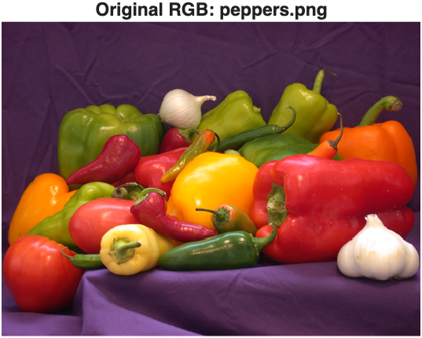
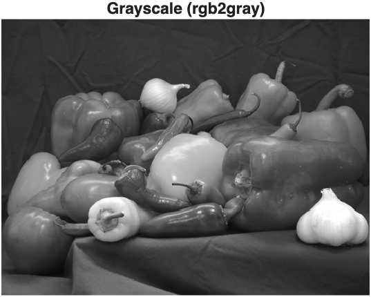
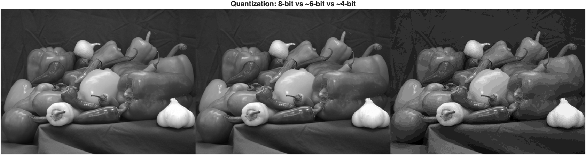
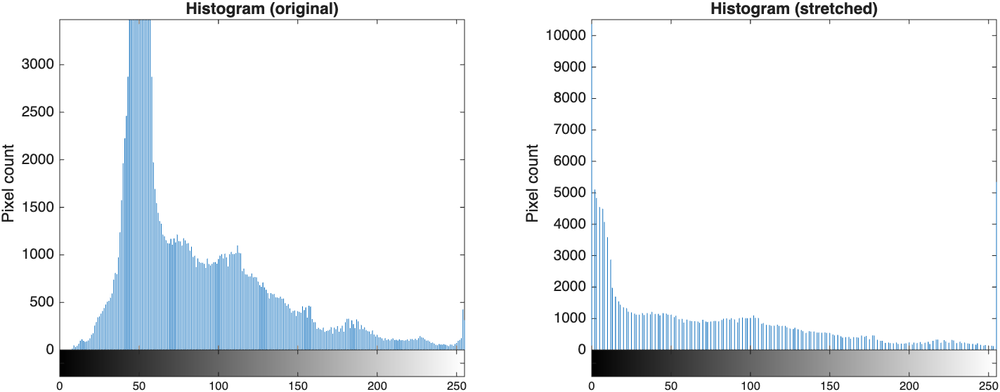
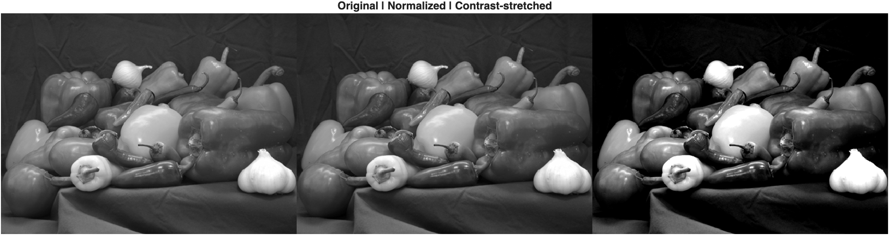
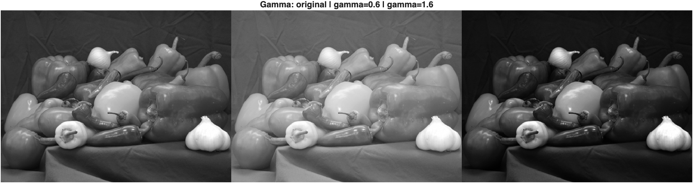
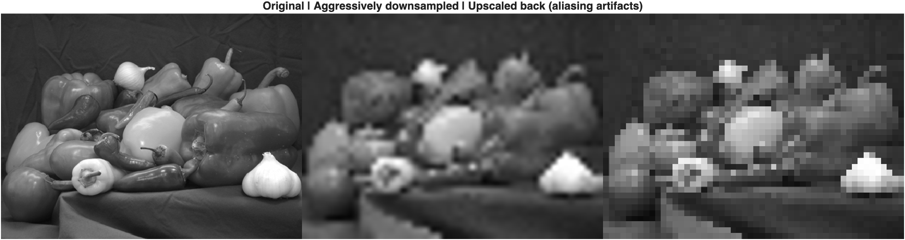
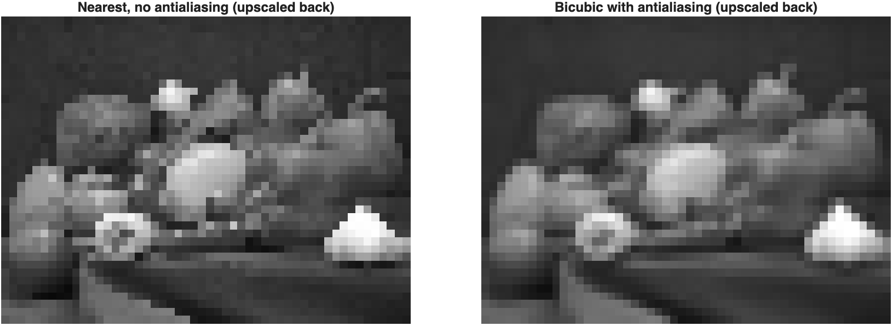
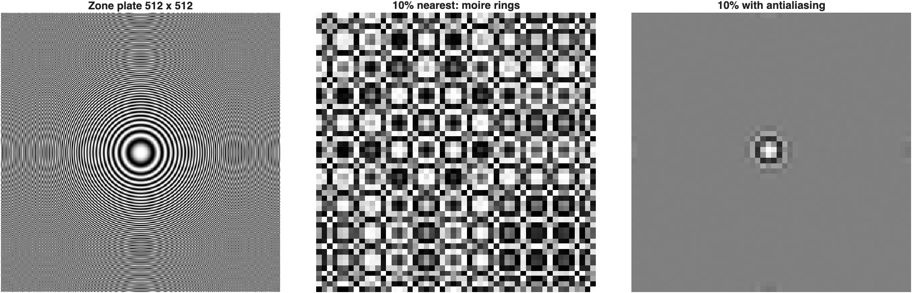

# Lecture 09: Image as a 2D Signal (Lab 1)

This lab treats a digital image as a sampled, quantized 2D signal. It covers quantization (bit depth), histograms and contrast stretching, gamma correction, and sampling with aliasing.

---

## Files

- [`Lecture09_lab1_image_2d_signal.m`](Lecture09_lab1_image_2d_signal.m): the lab script. It saves every figure to `figures/`.
- `figures/`: the screenshots used below.

The image is `peppers.png`, a MATLAB sample image. It is not included in the repository. The script falls back to `cameraman.tif` if `peppers.png` is missing.

| Item | Value |
|---|---|
| MATLAB version | 26.2.0.3433840 (R2026b) Update 1 (local). A run in MATLAB Online, R2026b Update 2, printed identical numbers. |
| Image | `peppers.png`, converted to grayscale with `rgb2gray` |

### Changes to the lab handout

- **Fix:** the handout's `fprintf` line contained `I(smile)`, an emoji that replaced the colon operator. The script uses `I(:)`.
- **Added:** every figure is saved with `exportgraphics`, and the script prints the numbers used in the reflections.
- **Added in Section 4:** an antialiased downsampling for comparison.
- **Optional Section 5:** implemented with a synthetic zone-plate image, because `peppers.png` has no fine stripes.

## How to run

```bash
cd Lecture09/Lab1 && matlab -batch "run('Lecture09_lab1_image_2d_signal.m')"
```

In MATLAB Online, open the script, click **Run**, and download the PNG files from `figures/`.

---

## 0) Load and inspect




The grayscale image is `uint8`, 384 × 512 pixels, with values from 8 to 255. It uses 248 different grey levels, and its mean is 81.7, so it is a fairly dark image.

`rgb2gray` computes the luminance $Y = 0.2989R + 0.5870G + 0.1140B$. The result is one `uint8` sample per pixel: a 2D signal with amplitude values from 0 to 255.

## 1) Quantization and dynamic range



Quantization with step 4 keeps 64 possible levels (~6 bits); step 16 keeps 16 levels (~4 bits). The image actually uses **248, 62 and 16** distinct grey levels at 8, ~6 and ~4 bits. The quantization error is at most 3 and 15 grey levels respectively.

- **~6 bits:** no visible difference from the original.
- **~4 bits:** clear posterization. The dark background cloth breaks into flat blotches with sharp borders, and the smooth surfaces of the large peppers and the garlic show bands of constant grey instead of gradual shading.

## 2) Histogram and contrast stretching




`mat2gray` maps the image's own minimum and maximum to 0 and 1. `imadjust(I,[0.2 0.8],[0 1])` maps input levels 51–204 linearly to 0–255 (slope $1/0.6 \approx 1.67$). Everything below 51 becomes 0 and everything above 204 becomes 255.

- **Normalized (`mat2gray`):** the original range is already [8, 255], so normalization only moves the darkest level from 8 to 0. The image looks practically unchanged.
- **Contrast-stretched:** the standard deviation of the grey levels rises from 46.6 to 70.5, so the histogram is spread over the full range. Only 154 of the 256 output levels are used, because the 154 input levels 51–204 are spread out with gaps in between: the histogram becomes a comb.
- **Clipping:** the image is dark, so the stretch clips **30.4 %** of all pixels to black (input < 51) and 2.7 % to white (input > 204). These show as tall spikes at 0 and 255. The spike at 0 holds about 60 000 pixels and runs off the top of the plot. In the image, the background cloth turns almost completely black, while the peppers and garlic gain contrast.

## 3) Gamma correction



`imadjust(I,[],[],gamma)` computes $y = x^{\gamma}$ on the normalized grey level $x \in [0, 1]$. For $\gamma = 0.6$, $x^{0.6} > x$ for every $0 < x < 1$, so the image brightens. Dark tones gain the most. For $\gamma = 1.6$, $x^{1.6} < x$, so it darkens. Black and white stay fixed. Unlike contrast stretching, this is a nonlinear remapping.

The mean grey level rises from 81.7 to **124.4** with $\gamma = 0.6$ and falls to **47.3** with $\gamma = 1.6$.

## 4) Sampling and aliasing




`imresize(I,0.1,'nearest')` keeps one pixel out of every 10 × 10 block: the 384 × 512 image becomes 39 × 52.

- **Middle panel:** `montage` enlarges the 39 × 52 image to the size of the first image with its own smooth interpolation. It therefore looks blurred, but the stair-stepped outlines of the table edge and the garlic show how few samples are left.
- **Right panel:** upscaling with `'nearest'` copies every sample into a 10 × 10 block. The blocks are an interpolation effect, not aliasing.
- **Aliasing** shows in the comparison figure. With `'nearest'`, each block takes the value of a single pixel. Small details such as stems, highlights and cloth wrinkles either vanish or appear as isolated blocks much brighter or darker than their neighbours, depending on where a sample happens to land. The background turns into random-looking speckle. The antialiased version averages each block first, so it has the same resolution but gives smooth, consistent tones without that speckle.

## 5) Optional: moiré



The zone plate $\cos(\pi r^2 / N)$ has a local frequency of $r/N$ cycles/pixel. That frequency rises from 0 at the centre to 0.5 cycles/pixel at the edge. After sampling at 10 %, the new Nyquist limit is 0.05 cycles/pixel, which the zone plate reaches at a radius of only 26 px (of 256).

- **Nearest, 10 %:** the real pattern is a single set of rings around one centre. The sampled version shows a regular lattice of false ring centres all over the image. Each ring pattern beyond radius 26 px is above the new Nyquist limit and folds back to a low frequency, which appears as these new, false centres. This is moiré.
- **With antialiasing:** the low-pass filter keeps only the few rings near the centre, inside the 26 px radius, and turns everything else into flat grey. The fine rings are lost, because 52 × 52 pixels cannot represent them, but no false pattern is created.

The left panel itself is drawn smaller than 512 × 512 on screen, so it can show faint moiré from the display resampling. The pattern in the middle panel is in the image data.

---

## 6) Short reflections

**1. Bit depth and banding.** **Fewer bits mean larger quantization steps. Once a step is large enough to see, smooth gradients turn into flat bands with visible edges: banding, or posterization.**

At ~6 bits the step is 4 grey levels, below what is visible, so the image looks unchanged. At ~4 bits the step is 16 grey levels and only 16 levels remain. The slowly varying background cloth and the smooth pepper surfaces, where neighbouring pixels differ by less than one step, collapse into patches of constant grey with false contours between them. Textured, high-contrast areas hide the effect better than smooth ones.

**2. Contrast stretching and the histogram.** **Stretching spreads the mid-range of the histogram over the full 0–255 range: mid-tone details gain contrast, but the shadows and highlights outside 51–204 are lost.**

The linear map multiplies grey-level differences by about 1.67, so the standard deviation rises from 46.6 to 70.5 and small mid-tone differences become easier to see. No new levels are created: the 154 input levels are only spaced further apart, so the histogram becomes a comb with empty bins. Everything outside the input window is clipped. For this dark image that is 30.4 % of the pixels sent to pure black, so detail in the shadows disappears. A window chosen from the histogram, for example with `stretchlim`, would clip less.

**3. Why aggressive downsampling causes aliasing.** **Keeping only every 10th pixel lowers the sampling rate tenfold, and nothing removes the detail that the new grid can no longer represent.**

The original grid samples at 1 sample/pixel, so its Nyquist limit is 0.5 cycles/pixel. After `imresize(I,0.1,'nearest')` the image is sampled every 10 pixels: 0.1 samples/pixel, with a Nyquist limit of 0.05 cycles/pixel. Any detail with a period shorter than 20 original pixels is above that limit. `'nearest'` does no low-pass filtering, so that detail is not removed. It folds back to a lower, false frequency: edges become jagged staircases, and fine patterns turn into coarse false ones such as the moiré rings in Section 5. Upscaling back with `'nearest'` cannot undo this. It only enlarges each sample into a 10×10 block. A low-pass filter before sampling (`imresize`'s default antialiasing) removes the frequencies above the new Nyquist limit first. The result is blurred, but it has no false patterns.
