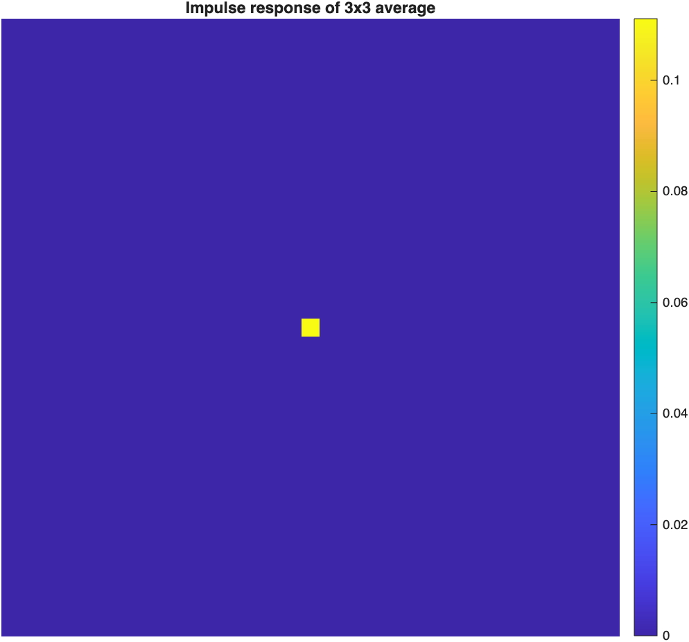
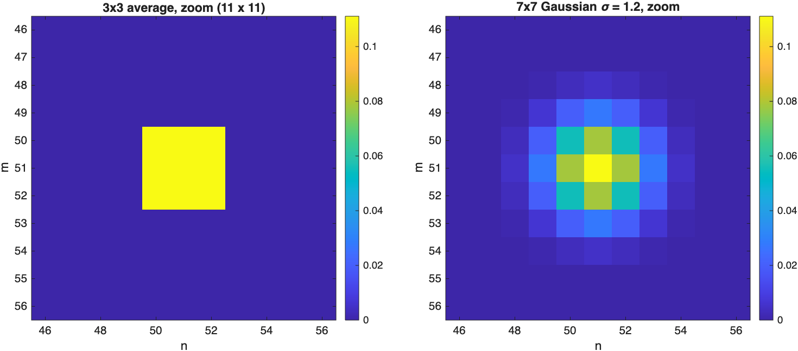
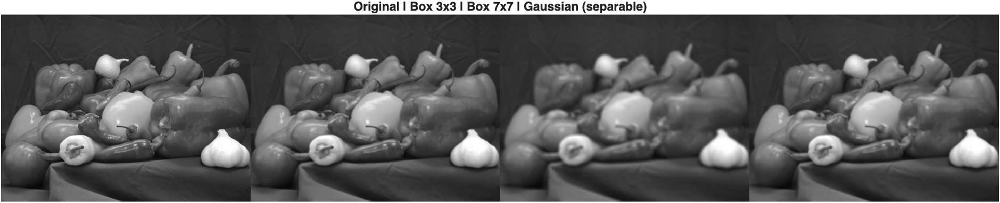
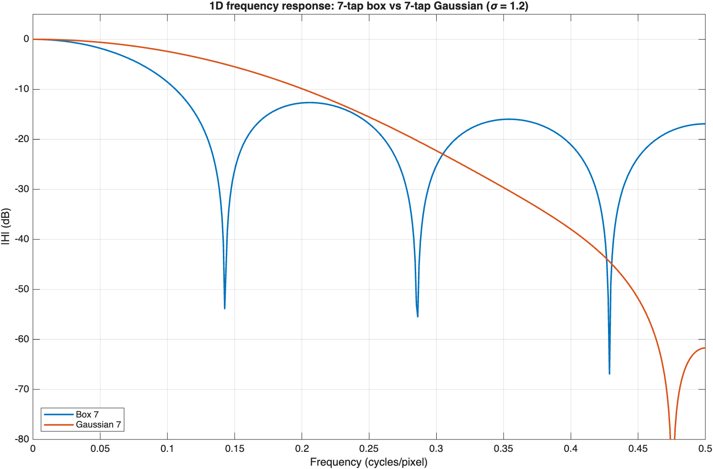
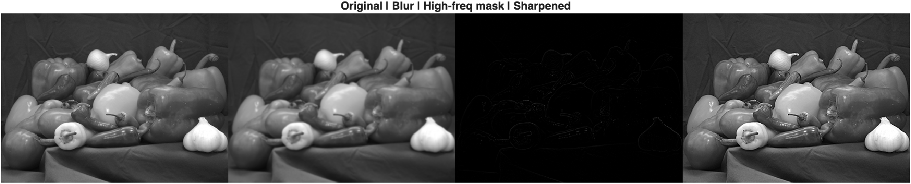
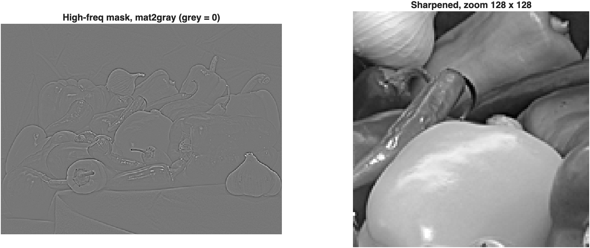
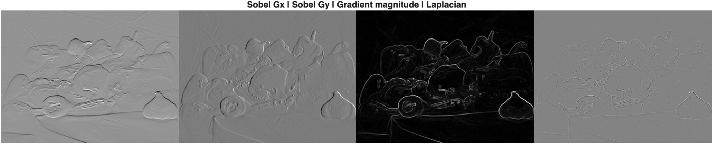
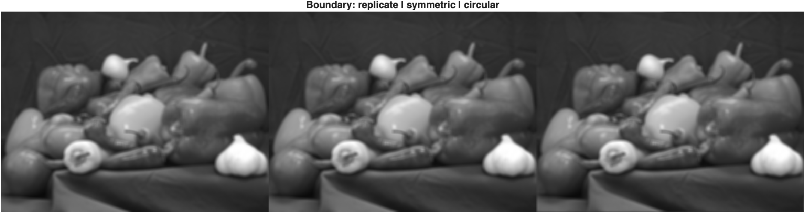
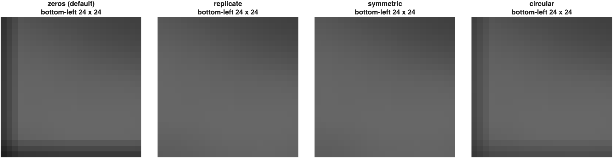

# Lecture 09: 2D Convolution & FIR Filters (Lab 2)

This lab treats image filters as 2D FIR systems: the kernel is the impulse response $h[m,n]$, and filtering is 2D convolution. It covers blurring (box and Gaussian), sharpening (unsharp masking), edge detection (Sobel, Laplacian), correlation vs convolution, and boundary handling.

---

## Files

- [`Lecture09_lab2_convolution_fir.m`](Lecture09_lab2_convolution_fir.m): the lab script. It saves every figure to `figures/`.
- `figures/`: the screenshots used below.

| Item | Value |
|---|---|
| MATLAB version | 26.2.0.3433840 (R2026b) Update 1 |
| Image | `peppers.png` (MATLAB sample image, not included), converted to grayscale and to `double` in [0, 1]; 384 × 512 |

### Additions to the lab handout

The lab's own code is unchanged. The script adds:

- figure saving and printed numbers for the reflections;
- a zoom on the impulse responses and the 1D frequency response of the box and Gaussian kernels;
- a timing of a 2D kernel against two separable 1D passes;
- the sharpening mask scaled with `mat2gray`, because `montage` clips its negative values;
- a convolution vs correlation test with an asymmetric kernel;
- a corner zoom of the boundary modes, including `imfilter`'s default zero padding.

## How to run

```bash
cd Lecture09_Image_Processing_Labs/Lab2 && /Applications/MATLAB_R2026b.app/bin/matlab -batch "run('Lecture09_lab2_convolution_fir.m')"
```

---

## 1) Delta image & impulse response




Filtering a unit impulse $\delta[m,n]$ returns the kernel itself, so the output *is* the impulse response. The 3×3 average gives a flat 3×3 square of value $1/9 \approx 0.111$. The 7×7 Gaussian ($\sigma = 1.2$) gives a smooth bell that is largest at the centre. Both sum to 1.0000, so neither changes the mean brightness (DC gain 1).

## 2) Low-pass: box vs Gaussian, separability




All three filters blur the image. The 7×7 box blurs most: its spread is 2.00 px against $\sigma = 1.2$ px for the Gaussian. The frequency responses show the difference in kind:

- **Box 7:** its response is a sinc-like curve. It has a first zero at 1/7 ≈ 0.143 cycles/pixel, but then rises again into sidelobes as high as **−12.7 dB**. Some fine detail therefore passes through, partly with inverted sign, while nearby frequencies are blocked.
- **Gaussian 7:** its response decreases steadily, from −15.5 dB at 0.25 cycles/pixel to −61.7 dB at 0.5 cycles/pixel. The only notch, near 0.475 cycles/pixel and more than 60 dB down, comes from cutting the Gaussian to 7 taps.

Both kernels are separable, $h[m,n] = g[m]\,g[n]$, so they can be applied as two 1D passes (see reflection 2).

## 3) Unsharp masking




The mask $I - I_{blur}$ holds the high frequencies that the Gaussian removed. It lies in [−0.312, 0.357] and is negative for 50.1 % of the pixels. `montage` clips negative values to black, so the mask panel above looks almost empty. With `mat2gray` (second figure), zero becomes mid-grey and the mask shows as a relief of the object outlines.

Adding the mask back ($I + 1.0 \cdot \text{mask}$) boosts exactly those details: outlines and highlights look crisper. Only 0.33 % of the pixels leave [0, 1] and are clipped. Unsharp masking also amplifies noise, and with a larger gain it creates bright and dark halos along strong edges.

## 4) Edges: Sobel & Laplacian



`fspecial('sobel')` returns `[1 2 1; 0 0 0; -1 -2 -1]`. This kernel differentiates **vertically**, so the panel the lab calls "Gx" responds to **horizontal** edges, such as the table edge, and "Gy" (the transposed kernel) responds to vertical edges. The signed outputs look like an embossed relief lit from one side. The gradient magnitude $\sqrt{G_x^2 + G_y^2}$ combines both into outlines independent of edge direction.

The Laplacian (`fspecial('laplacian', 0.2)`, centre −3.33) is a second derivative: thin double lines along edges, and noisier than Sobel. Both kernels sum to 0, so flat regions give 0. This shows as mid-grey after `mat2gray`.

## 5) Correlation vs convolution

`conv2` and `imfilter(...,'conv')` differ by at most **3.3 × 10⁻¹⁶**, which is rounding error: both compute the same convolution with zero padding. The test cannot show a flip, though, because the box kernel is symmetric: `isequal(h, rot90(h,2))` is true. With the asymmetric Sobel kernel, correlation and convolution differ by up to 5.906, and `conv = −corr` exactly. Convolution rotates the kernel by 180°, which turns this Sobel kernel into its negative. `imfilter` correlates by default, so for asymmetric kernels the choice matters.

## 6) Boundary handling




The full images look identical, because a 7×7 kernel only reaches 3 pixels past the border. Everywhere else the modes agree exactly: the interior difference is 0. The bottom-left corner zoom shows the differences:

- **zeros** (the `imfilter` default) pads with black: the last 3 rows and columns darken (up to 0.240 different from replicate).
- **replicate** repeats the edge pixel, and **symmetric** mirrors the image. Both continue the image naturally and look almost the same (max difference 0.068).
- **circular** wraps around: the bottom rows are averaged with the top rows, and the left columns with the right ones. The top of this image is darker (mean 0.182) than the bottom (0.281), so a dark band appears along the bottom and left edges (up to 0.139 different).

---

## 7) Reflections

**1. Why is a Gaussian preferred over a large box low-pass?** **Its frequency response falls off smoothly and has no sidelobes, so it blurs without artifacts.**

The box's response is a sinc with sidelobes up to −12.7 dB. Some high frequencies leak through, partly with inverted sign, which can create blocky or ringing artifacts. The Gaussian's response is itself a Gaussian and decreases steadily, so fine detail is attenuated more the finer it is. In the spatial domain, the Gaussian weights nearby pixels more than distant ones, and it has no sharp cut-off at the kernel edge. It is also separable and rotationally symmetric, so it blurs the same in every direction.

**2. What does separability do for computational cost?** **A separable $k \times k$ kernel can be applied as two 1D passes, which reduces the work per pixel from $k^2$ to $2k$ multiplications.**

For the lab's 7×7 kernels that is 49 vs 14 multiplications per pixel. For a 31×31 Gaussian it is 961 vs 62. Measured with `conv2` on this image, the separable version ran in 1.03 ms against 5.47 ms for the full 2D kernel (5.3× faster; the exact times vary slightly between runs), with a maximum difference of $2.7 \times 10^{-15}$. The saving grows with kernel size. A box and a Gaussian are separable; a general kernel, such as a disk, is not.

**3. How do boundary modes change corners/edges?** **They only change a border as wide as half the kernel, because they decide which values are assumed outside the image.**

With a 7×7 kernel that border is 3 pixels; the interior is identical in all modes. Zero padding darkens the border. `circular` brings in content from the opposite side of the image, here a darker band at the bottom and left. `replicate` and `symmetric` continue the image and give the most natural edges. Corners are affected most, because there the kernel extends outside the image in two directions.
