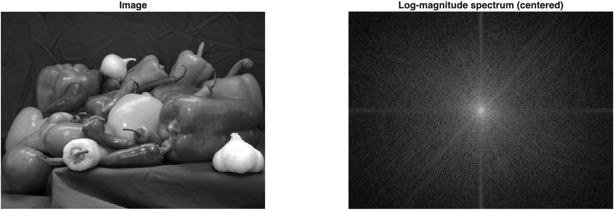
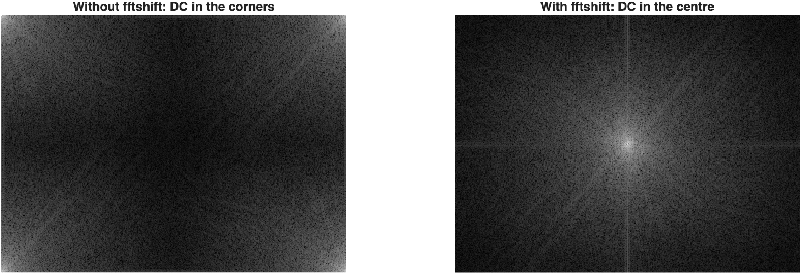
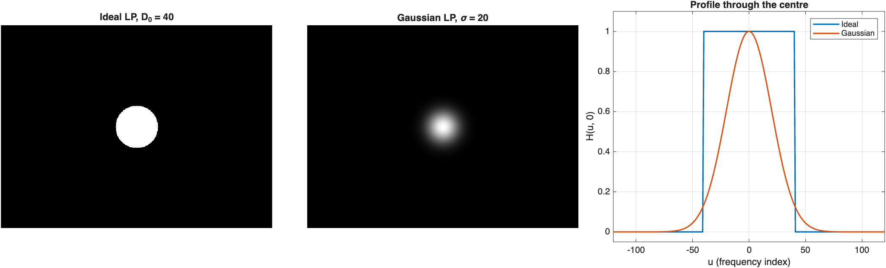
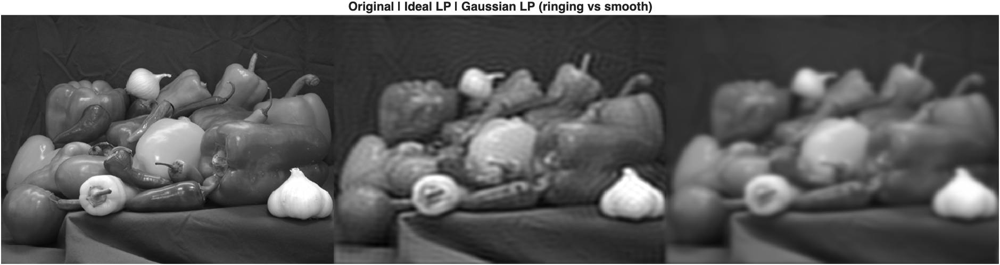
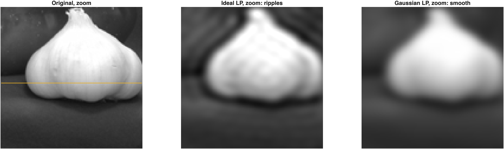
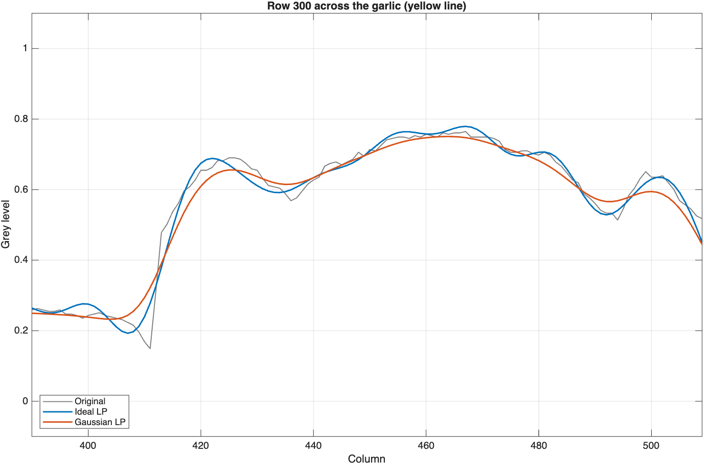
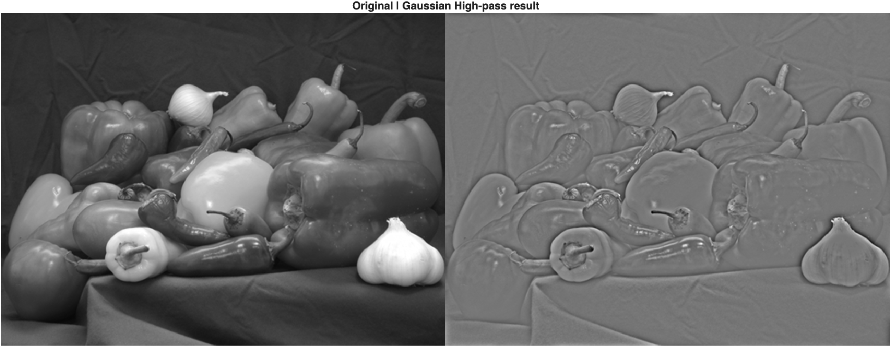
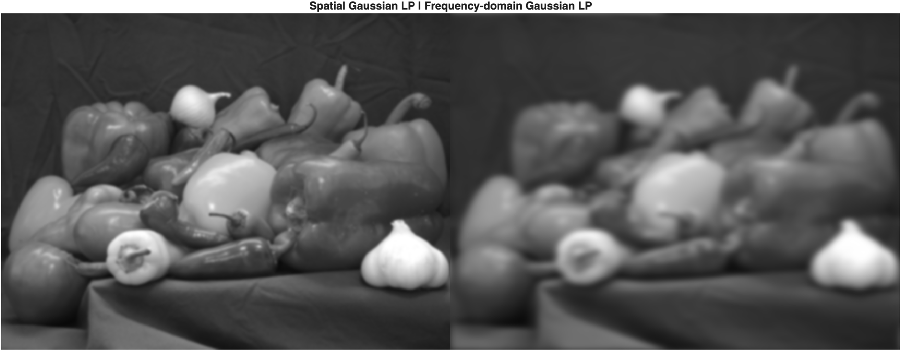
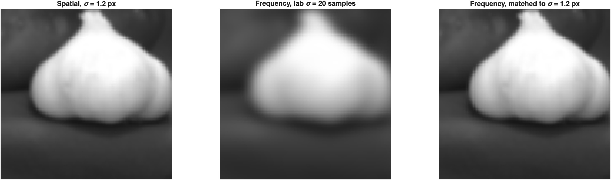
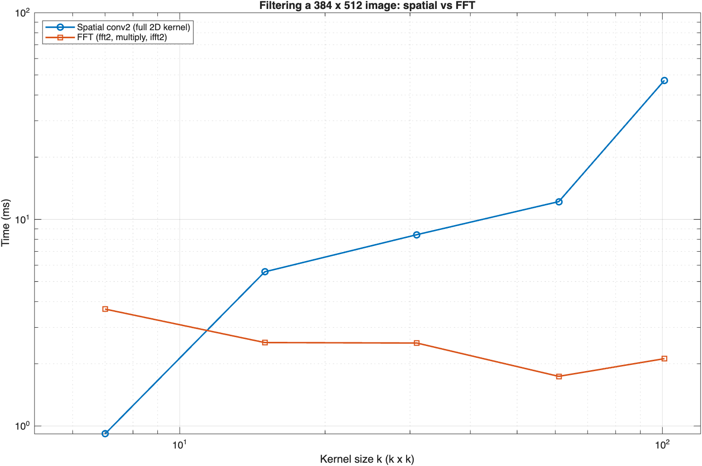

# Lecture 09: Frequency-Domain Filtering with fft2 (Lab 3)

This lab filters an image in the frequency domain. `fft2` gives the 2D spectrum, which is multiplied by a filter mask $H(u,v)$ and transformed back with `ifft2`. It compares an ideal and a Gaussian low-pass, builds a high-pass as the complement, and compares spatial with frequency-domain Gaussian filtering. By the convolution theorem, multiplying spectra is the same as convolving the images.

---

## Files

- [`Lecture09_lab3_frequency_filtering.m`](Lecture09_lab3_frequency_filtering.m): the lab script. It saves every figure to `figures/`.
- `figures/`: the screenshots used below.

| Item | Value |
|---|---|
| MATLAB version | 26.2.0.3433840 (R2026b) Update 1 |
| Image | `peppers.png` (MATLAB sample image, not included), grayscale `double` in [0, 1]; M = 384 rows, N = 512 columns |

### Additions to the lab handout

The lab's own code is unchanged. The script adds:

- figure saving and printed numbers;
- the spectrum without `fftshift`;
- the two filter masks and their profiles;
- a zoom and a brightness profile across an edge to show ringing;
- a frequency-domain Gaussian matched to the spatial one in Section 5, because the lab's two Gaussians do not have the same width (see Section 5);
- a timing of spatial vs FFT filtering for reflection 3.

## How to run

```bash
cd Lecture09_Image_Processing_Labs/Lab3 && /Applications/MATLAB_R2026b.app/bin/matlab -batch "run('Lecture09_lab3_frequency_filtering.m')"
```

---

## 1) Magnitude spectrum




The log-magnitude spectrum is brightest at the centre (low frequencies) and falls off outwards. Most of the image's energy lies in slow brightness changes. The centre value is the DC term: $F(0,0) = 62960.3 = M N \cdot \text{mean}(I)$. Two more features are visible:

- **Bright diagonal streaks:** they run perpendicular to strong straight edges in the image, such as the table edge.
- **A bright horizontal and vertical cross through the centre:** `fft2` treats the image as periodic, so the jump between its opposite borders acts like an extra edge.

The log is needed because the magnitudes span many orders of magnitude. Without it, only the DC point would be visible.

## 2) Ideal & Gaussian low-pass masks



- **Ideal LP:** passes everything within radius $D_0 = 40$ unchanged and blocks everything outside: a hard step from 1 to 0.
- **Gaussian LP:** $H = e^{-D^2/2\sigma^2}$ with $\sigma = 20$ falls smoothly from 1 to 0.

Without the DC term, the ideal mask keeps 97.30 % of the spectral energy and the Gaussian 86.86 %. The Gaussian already attenuates frequencies well inside $D_0$.

## 3) Low-pass filtering





Both results are blurred. The ideal LP also shows **ringing**: faint ripples that repeat the outlines of the objects, most visible in the background around the peppers and around the garlic in the zoom. The profile across the garlic's left edge shows the cause:

- The ideal LP dips to 0.19 just before the edge, below the background level of 0.25, and overshoots to 0.69 just after it (Gaussian: 0.65). A further ripple appears at column 399.
- Its output range is [0.011, **1.053**]: it goes above white, although the input never exceeds 1.000.
- The Gaussian LP rises monotonically through the edge and stays inside the input range ([0.046, 0.996]).

The result of `ifft2` has an imaginary part of exactly 0, because both masks are symmetric about the centre. `real()` therefore loses nothing.

## 4) High-pass via complement



$H_{HP} = 1 - H_{LP}$ blocks what the low-pass keeps. It removes the DC term ($H_{HP}(0,0) = 0$) and the slow brightness variations, and keeps edges and fine texture: the pepper outlines, the garlic's ribs and the wrinkles in the cloth. After `mat2gray`, zero maps to mid-grey, so flat regions appear as uniform grey and edges as light and dark lines.

## 5) Spatial vs frequency-domain Gaussian LP




**The lab's two Gaussians do not match, because they have different widths.**

- The spatial filter has $\sigma = 1.2$ px.
- The frequency mask has $\sigma = 20$ frequency samples. A Gaussian of width $\sigma_f$ samples in the DFT corresponds to a spatial Gaussian of width $N/(2\pi\sigma_f)$. That gives **4.07 px horizontally and 3.06 px vertically**: the image is not square, so the same mask is wider in one direction.

The frequency-domain result is therefore clearly blurrier. In the interior, it differs from the spatial result by up to 0.293 (mean 0.0155).

A frequency mask matched to $\sigma = 1.2$ px is $H = e^{-2\pi^2 \sigma^2 \left((u/N)^2 + (v/M)^2\right)}$. With it, the two methods agree within **0.0022** in the interior (mean difference 0.00009). The small remainder comes from cutting the spatial kernel to 7×7. Near the border, the difference rises to 0.112, because the two methods treat the border differently:

- the FFT treats the image as periodic, so the border is filtered with pixels from the opposite side;
- `imfilter` here uses `'replicate'` padding.

This is the convolution theorem in practice: filtering in either domain gives the same result when the filters correspond and the borders are handled the same way.

---

## 6) Reflections

**1. Why does an ideal low-pass cause ringing (Gibbs phenomenon)?** **A hard cut-off in frequency corresponds to a sinc-shaped impulse response in space, and its oscillating side lobes turn into ripples next to every edge.**

The ideal mask is a disk with a sharp edge. Its inverse transform, the spatial impulse response, is a 2D sinc-like function (a jinc). It has a main lobe and then decaying positive and negative rings. Convolving the image with it places these rings along every edge: overshoot, undershoot and further ripples, as in the profile above (0.19 below a 0.25 background, values up to 1.053). This is the Gibbs phenomenon. A sharp transition cannot be built from a truncated set of frequencies without overshoot, and making $D_0$ larger only makes the ripples narrower, not smaller. The Gaussian mask has no sharp edge, and its impulse response is again a Gaussian, positive everywhere. It therefore blurs without ringing.

**2. What does `fftshift` do visually?** **It moves the zero-frequency (DC) term from the top-left corner to the centre of the spectrum image.**

`fft2` stores frequencies starting at 0, so the low frequencies end up in the four corners and the high frequencies in the middle (left panel of the `fftshift` figure). `fftshift` swaps the quadrants diagonally. Low frequencies are then in the centre and frequency rises with distance from it, which matches how $D = \sqrt{u^2+v^2}$ and the masks are defined. `ifftshift` undoes the swap before `ifft2`. It changes only the arrangement, not the values.

**3. When is frequency-domain filtering computationally preferable?** **When the kernel is large: the FFT cost does not depend on the kernel size, while direct convolution grows with the kernel area.**

Direct convolution with a $k \times k$ kernel costs about $k^2$ operations per pixel. FFT filtering costs about $O(MN \log MN)$ for the whole image, whatever the kernel size. Measured on this 384 × 512 image:

| Kernel size | Spatial `conv2` (ms) | FFT (ms) |
|---|---|---|
| 7 × 7 | 0.92 | 3.68 |
| 15 × 15 | 5.57 | 2.53 |
| 31 × 31 | 8.43 | 2.52 |
| 61 × 61 | 12.19 | 1.74 |
| 101 × 101 | 47.07 | 2.12 |



The crossover is between 7 × 7 and 15 × 15. Above it, the FFT stays at about 2–4 ms (the exact times vary between runs), while direct convolution keeps growing. The FFT is also preferable for filters that are defined in the frequency domain in the first place, such as an ideal cut-off or a notch, or when one spectrum is reused for many filters. For small or separable kernels, spatial filtering is faster. It also handles borders more flexibly, because the FFT always implies periodic (circular) borders.
