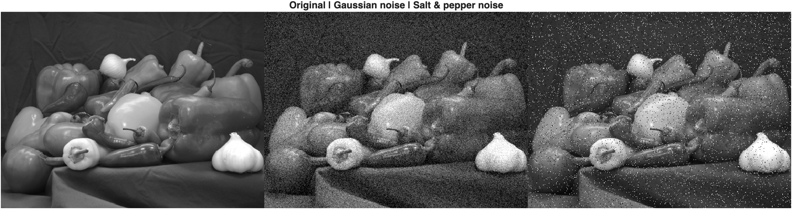
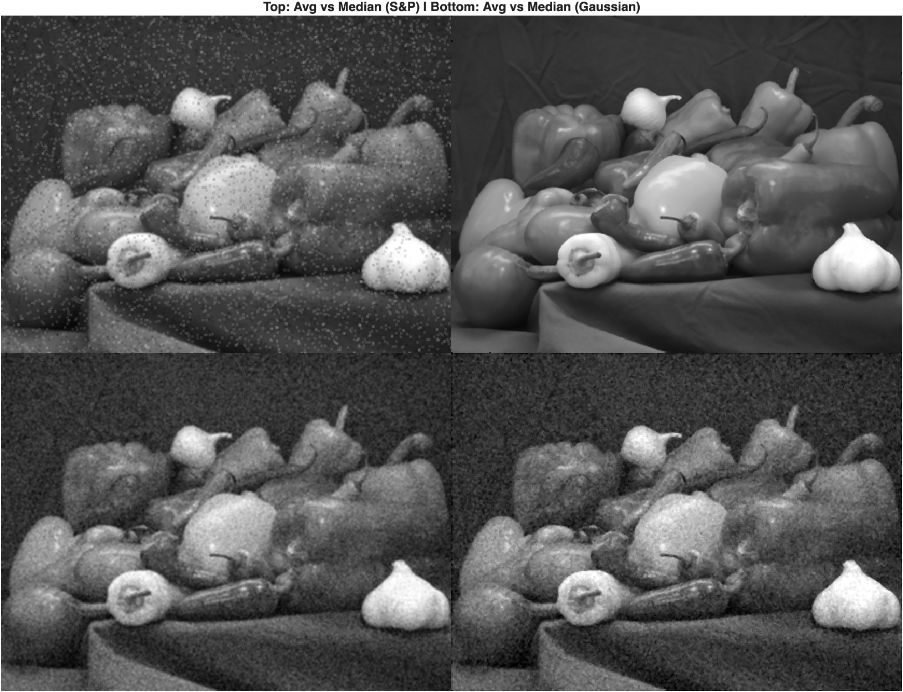
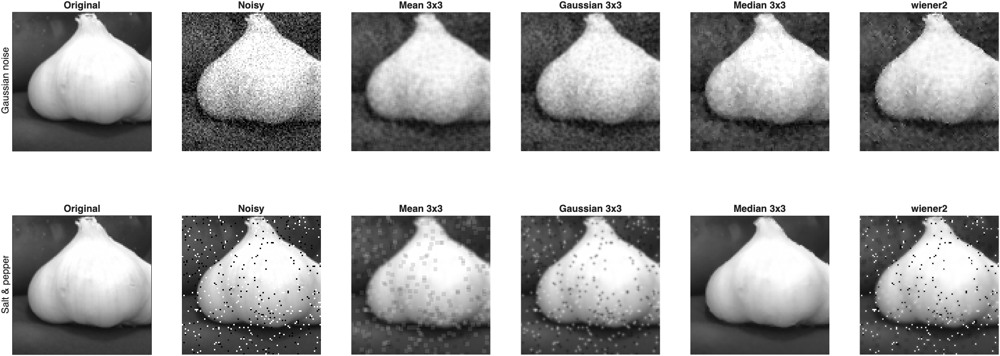
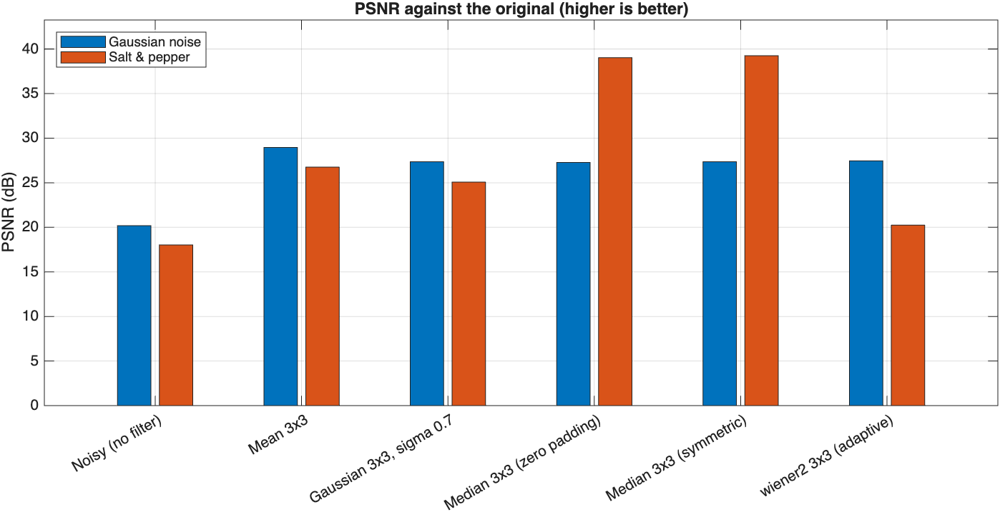
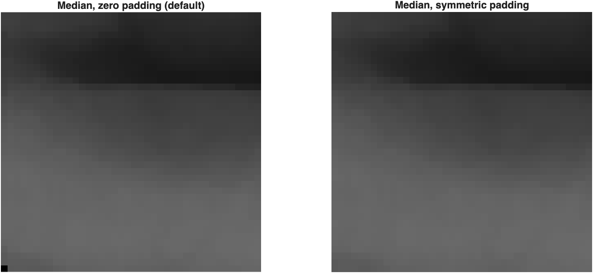
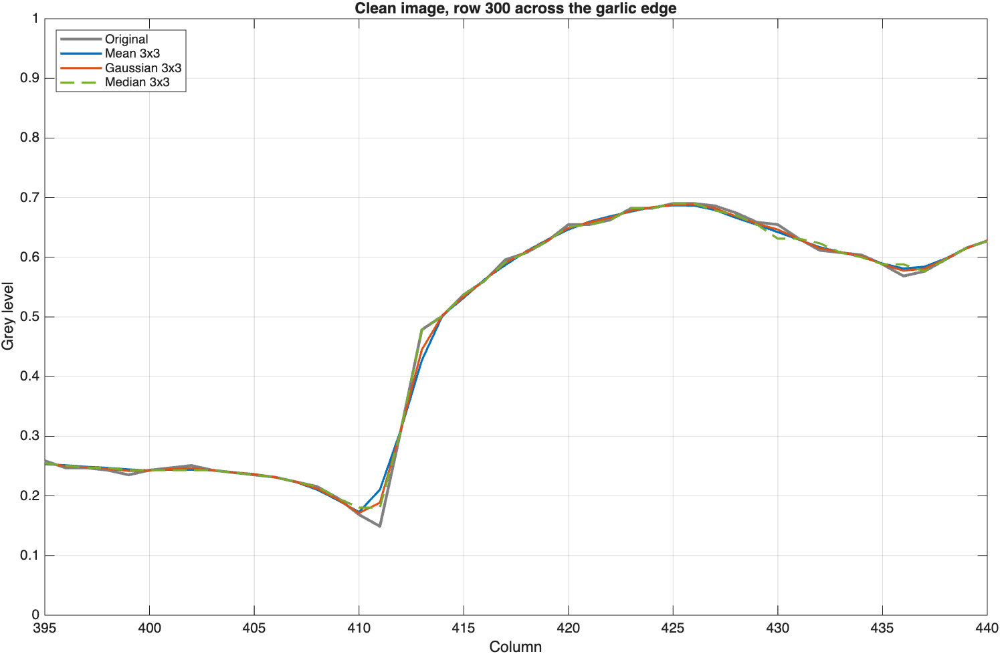

# Lecture 09: Noise and Filtering (Lab 4)

This lab models two common noise types (Gaussian and salt-and-pepper), measures image quality with MSE and SNR, and compares mean, Gaussian and median filters for noise reduction.

---

## Files

- [`Lecture09_lab4_noise_filtering.m`](Lecture09_lab4_noise_filtering.m): the lab script. It saves every figure to `figures/`.
- `figures/`: the screenshots used below.

| Item | Value |
|---|---|
| MATLAB version | 26.2.0.3433840 (R2026b) Update 1 |
| Image | `peppers.png` (MATLAB sample image, not included), grayscale `double` in [0, 1]; 384 × 512 |

### Additions to the lab handout

The lab's own code is unchanged. The script adds:

- **`rng(42)` before `imnoise`:** without a fixed seed the noise, and every number below, would change on each run.
- **SNR and PSNR next to MSE:** SNR is a learning outcome, but the lab code does not compute it.
- **A table with every filter on both noise types.** It includes the Gaussian filter that the lab computes but never shows, a median with `'symmetric'` padding, and `wiener2` as an example of an adaptive filter.
- **Edge-blurring evidence:** the MSE split into edge and flat pixels, a zoom and an edge profile.

$\text{SNR} = 10\log_{10}\dfrac{\sum I^2}{\sum (J - I)^2}$ in dB, where $I$ is the original and $J$ the noisy or filtered image. PSNR uses the peak value 1 instead of the signal power: $\text{PSNR} = 10\log_{10}(1/\text{MSE})$.

## How to run

```bash
cd Lecture09_Image_Processing_Labs/Lab4 && /Applications/MATLAB_R2026b.app/bin/matlab -batch "run('Lecture09_lab4_noise_filtering.m')"
```

---

## 1) Noise types



- **Gaussian noise** (`'gaussian', 0, 0.01`) adds a random value to *every* pixel, with standard deviation $\sqrt{0.01} = 0.1$. The measured standard deviation is 0.098, slightly lower because values are clipped to [0, 1]. The image looks grainy everywhere.
- **Salt & pepper** (density 0.05) replaces 4.97 % of the pixels with pure black or white and leaves all others untouched. The image shows isolated black and white dots.

## 2) Quality metrics of the noisy images

| Noise | MSE | SNR (dB) | PSNR (dB) |
|---|---|---|---|
| Gaussian | 0.0096 | 11.51 | 20.18 |
| Salt & pepper | 0.0158 | 9.36 | 18.02 |

Salt & pepper has the higher MSE although it changes only 5 % of the pixels. Each changed pixel jumps all the way to 0 or 1, and the error is squared, so a few large errors outweigh many small ones.

## 3–4) Linear and median filtering



- **Top (salt & pepper):** the mean filter (left) does not remove the impulses. It spreads each one into a faint grey 3×3 square. The median filter (right) removes them almost completely, and the image looks nearly like the original.
- **Bottom (Gaussian noise):** both filters reduce the grain, but neither removes it. The mean filter gives a smoother, slightly softer result. The median leaves a blotchy texture, because it picks one of the noisy values instead of averaging them.



The zoom on the garlic shows the same in detail, including the Gaussian 3×3 filter and `wiener2`. On salt & pepper, both linear filters leave grey spots, and `wiener2` leaves most impulses untouched.

## 5) Metrics after filtering

The lab prints `MSE S&P avg=0.0021, med=0.0001`. The full comparison:

| Method | Gaussian: MSE | SNR (dB) | PSNR (dB) | S&P: MSE | SNR (dB) | PSNR (dB) |
|---|---|---|---|---|---|---|
| Noisy (no filter) | 0.00959 | 11.51 | 20.18 | 0.01576 | 9.36 | 18.02 |
| Mean 3×3 | **0.00127** | **20.29** | **28.96** | 0.00211 | 18.09 | 26.75 |
| Gaussian 3×3, σ = 0.7 | 0.00184 | 18.68 | 27.35 | 0.00311 | 16.41 | 25.07 |
| Median 3×3 (zero padding, lab) | 0.00187 | 18.61 | 27.28 | 0.00012 | 30.37 | 39.03 |
| Median 3×3 (symmetric) | 0.00184 | 18.69 | 27.36 | **0.00012** | **30.59** | **39.25** |
| `wiener2` 3×3 (adaptive) | 0.00180 | 18.78 | 27.45 | 0.00945 | 11.58 | 20.25 |



- **Gaussian noise:** the mean filter is best (+8.8 dB SNR). It averages all 9 values with equal weight, which reduces random noise the most. The Gaussian kernel with σ = 0.7 puts most of its weight on the centre pixel, so it smooths less. The median and `wiener2` are close to it.
- **Salt & pepper:** the median is far ahead (+21 dB SNR; MSE 0.00012 against 0.00211 for the mean).
- **`wiener2` fails on salt & pepper** (only +2.2 dB). Its adaptive rule is explained in reflection 3.
- **Zero padding** in `medfilt2` only matters at the border: the four corner pixels become black, and the outermost rows and columns are pulled slightly darker. The effect on the whole-image metrics is small (27.28 vs 27.36 dB).



---

## 6) Reflections

**Which noise is best removed by the median filter? Why?** **Salt & pepper. The median ignores outliers, and salt-and-pepper pixels are outliers.**

In a 3×3 window, an impulse is one extreme value (0 or 1) among 9. Sorting the window puts it at one end, so the median, the middle value, is a normal neighbour. The impulse disappears completely, and the image is not blurred. An impulse survives only if at least 5 of the 9 pixels in the window are impulses of the same kind, which is very unlikely at 5 % density. Here the MSE drops from 0.0158 to 0.00012 (SNR 9.36 → 30.59 dB). A mean filter instead averages the impulse into its neighbours: it is spread into a grey square, not removed (MSE 0.00211). For Gaussian noise the median has no such advantage, because every pixel is slightly wrong and there is no outlier to reject.

**Why does linear filtering blur edges more?** **A linear filter averages across an edge without knowing it is there. The median, a non-linear filter, takes an existing value from one side of the edge.**

At an edge, a 3×3 window contains pixels from both the dark and the bright side. The mean replaces the centre with a weighted average of both, so it creates intermediate values: the step becomes a ramp. The median, on a clean step, returns the value of the majority side, so the step stays sharp. Measured on the **clean** image, where filtering is the only source of error, the error at edge pixels is:

| Filter on the clean image | Edge-pixel MSE |
|---|---|
| Mean 3×3 | 0.00067 |
| Gaussian 3×3, σ = 0.7 | 0.00031 |
| Median 3×3 | 0.00028 |

The mean filter blurs edges more than twice as much as the median. The Gaussian is close to the median here only because σ = 0.7 is very narrow; a wider Gaussian blurs more. On the noisy images, the mean filter's error is 1.6× larger at edges than in flat regions (0.00178 vs 0.00112). This is the price of its strong noise reduction in flat areas.



The profile across the garlic edge shows the same on a small scale: the mean filter raises the dark side and lowers the bright side of the step (columns 411–413). The median follows the original most closely.

**How could we design adaptive filters to preserve detail?** **Let the filter change its strength depending on the local image content: smooth strongly in flat regions, and weakly or not at all near edges and fine detail.**

- **Local statistics (Wiener):** `wiener2` estimates the local mean and variance in each window. Where the local variance is close to the noise variance, the region is flat and is smoothed towards the mean. Where it is much larger, the region is detail and is left almost unchanged.

  This works for Gaussian noise (SNR 11.51 → 18.78 dB). It fails on salt & pepper (only 11.58 dB), because every impulse creates a high local variance and is mistaken for detail. An adaptive filter must therefore match the noise model.
- **Adaptive median:** first detect likely impulses (pixels equal to 0 or 1, or far from their neighbourhood median), then replace only those and leave every other pixel untouched. This removes salt & pepper without touching detail.
- **Edge-aware smoothing:** the bilateral filter (`imbilatfilt`) weights neighbours by both distance and similarity in brightness, so it does not average across an edge. Anisotropic diffusion (`imdiffusefilt`) smooths along edges but not across them. Non-local means (`imnlmfilt`) averages similar patches from a wider area.
- **Edge-guided switching:** detect edges first, for example with Canny, then use a small kernel or no filtering near them and a larger one elsewhere.
