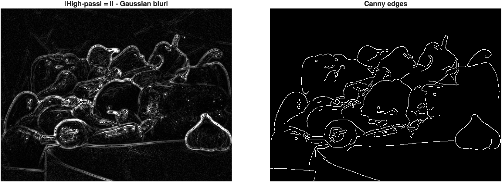
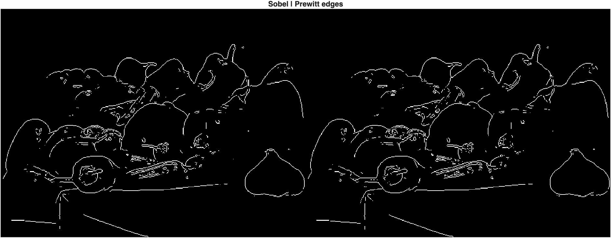
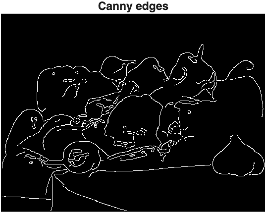
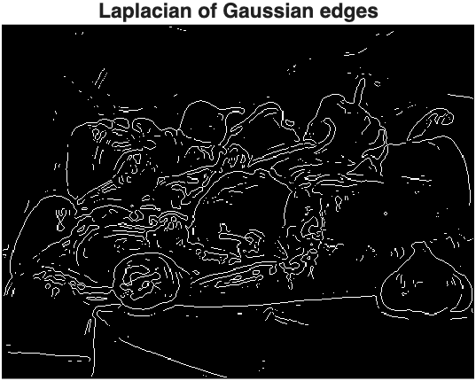
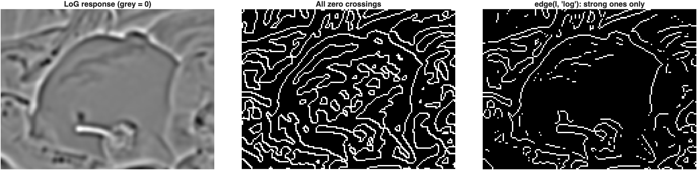
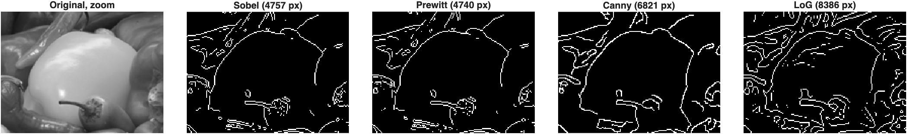
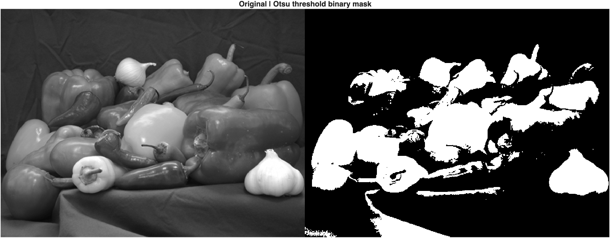
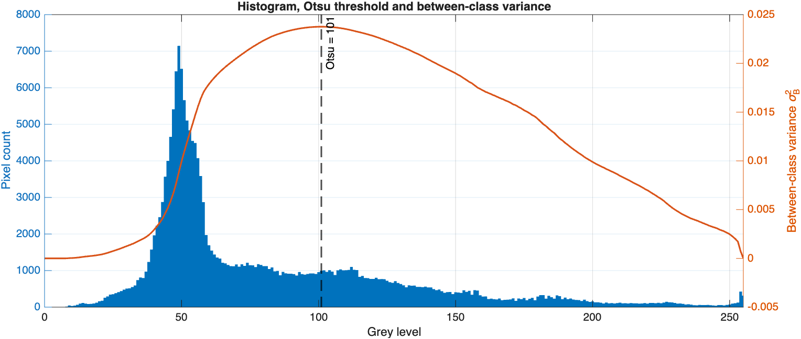
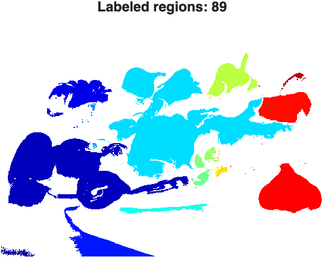

# Lecture 09: Edge Detection and Segmentation (Lab 5)

This lab relates edges to high-frequency components and compares four edge detectors:

- gradient-based: Sobel, Prewitt and Canny;
- zero-crossing based: the Laplacian of Gaussian (LoG).

It then segments the image with Otsu's automatic threshold and labels the resulting regions.

---

## Files

- [`Lecture09_lab5_edges_segmentation.m`](Lecture09_lab5_edges_segmentation.m): the lab script. It saves every figure to `figures/`.
- `figures/`: the screenshots used below.

| Item | Value |
|---|---|
| MATLAB version | 26.2.0.3433840 (R2026b) Update 1 |
| Image | `peppers.png` (MATLAB sample image, not included), grayscale `double` in [0, 1]; 384 × 512 |

### Additions to the lab handout

The lab's own code is unchanged. The script adds figure saving and:

- a comparison of edges with the high-pass image;
- the thresholds `edge` chose, and edge-pixel, fragment and thickness counts;
- a zoom comparing all four detectors;
- the LoG response with all its zero crossings;
- the histogram with the Otsu level and the between-class variance that Otsu maximises;
- region-size statistics after labelling.

## How to run

```bash
cd Lecture09_Image_Processing_Labs/Lab5 && /Applications/MATLAB_R2026b.app/bin/matlab -batch "run('Lecture09_lab5_edges_segmentation.m')"
```

---

## 0) Edges are high-frequency components



An edge is a fast change of brightness over a few pixels, and fast changes are high spatial frequencies. The high-pass image ($I$ minus a Gaussian blur with σ = 2) is therefore bright exactly along the object outlines. In flat regions it is close to zero. The Canny edge zone (edges widened by one pixel) covers only **11.2 %** of the pixels but holds **68.3 %** of the high-pass energy. Every edge detector is a form of high-pass filter, followed by a rule that decides which responses count as edges.

## 1) Sobel and Prewitt



Both estimate the gradient with a 3×3 derivative kernel and keep pixels where the gradient magnitude exceeds a threshold. `edge` chose the thresholds automatically: 0.0615 (Sobel) and 0.0604 (Prewitt). Sobel gives the centre row double weight, which smooths slightly more. On this image the two results are almost identical (4757 vs 4740 edge pixels). Both find the strong outlines, but the contours are broken into many short pieces, and weak edges are missing.

## 2) Canny



Canny with thresholds [0.05 0.2] gives long, continuous contours that follow the pepper and garlic outlines, with very little clutter. It finds more edge pixels than Sobel (6821), but in far fewer, longer pieces (see the table below).

## 3) Laplacian of Gaussian




The LoG first smooths with a Gaussian (σ = 2) and then takes the second derivative. At an edge the first derivative peaks, so the second derivative passes through zero. Edges are therefore the **zero crossings** of the LoG response, which is the sign change between light and dark in the left panel. The zero crossings form closed curves everywhere, including in flat, slightly textured regions: 40 606 pixels in total. `edge(I,'log')` keeps only the crossings with a steep slope (threshold 0.0026), which leaves 8386 pixels. Even so, LoG produces the most edge pixels and the most fragments. As a second derivative it reacts strongly to small brightness variations such as highlights and surface texture.

### All four detectors compared



| Detector | Edge pixels | Fragments | Fragments < 10 px | Mean fragment length (px) | 2×2 edge blocks |
|---|---|---|---|---|---|
| Sobel | 4757 | 336 | 240 | 14.2 | 0 |
| Prewitt | 4740 | 336 | 251 | 14.1 | 0 |
| **Canny** | 6821 | **89** | **3** | **76.6** | 30 (0.44 %) |
| LoG | 8386 | 622 | 444 | 13.5 | 11 (0.13 %) |

A "2×2 edge block" is a square of four edge pixels, which would mean the line is thicker than one pixel. All four detectors give essentially one-pixel-wide lines. The real difference is continuity: Canny's edges form a few long contours, while the others break into hundreds of short pieces.

## 4) Otsu threshold




Otsu's level is **0.3961 (grey level 101)**, and 27.5 % of the pixels become foreground. The histogram has a tall peak around grey level 50 (the dark background cloth) and a broad, flat spread of brighter values (the vegetables). The red curve is the between-class variance $\sigma_B^2(t)$ computed by the script. Its maximum lies exactly at grey level 101, which confirms what `graythresh` returned.

The mask captures the bright objects well: the garlic, the onion and the light peppers. The darker red peppers and the stems fall below 101 and are counted as background. One global threshold cannot separate objects that are as dark as the background.

## 5) Labelled regions



`bwlabel` finds **89** connected regions. Most of them are noise: 69 regions are smaller than 10 pixels, and the five largest hold 85.4 % of the foreground (19430, 15683, 5043, 2978 and 2965 px). Touching peppers merge into one large region (light blue), because a threshold alone has no way to separate them. A usable segmentation would need cleaning (`bwareaopen`, `imfill`) and a split of touching objects, for example with a distance transform and watershed.

---

## 6) Reflections

**Which operator gives the thinnest, cleanest edges?** **Canny.**

All four detectors give lines about one pixel wide. Sobel and Prewitt are thinned by `edge`, Canny uses non-maximum suppression, and LoG zero crossings are thin by nature. Canny's edges are by far the cleanest: 89 fragments with a mean length of 76.6 px, and only 3 shorter than 10 px. Sobel has 336 fragments (240 short), and LoG has 622 (444 short). In the zoom, Canny traces each outline as one continuous curve, while Sobel and Prewitt break it, and LoG adds many spurious bits from highlights and texture.

**Why does Canny outperform simple gradient filters?** **It is a multi-stage method. Each stage fixes one weakness of a plain gradient threshold.**

1. **Gaussian smoothing** first: noise and fine texture produce fewer false responses.
2. **Gradient magnitude and direction** (as in Sobel).
3. **Non-maximum suppression:** only the pixel with the largest gradient *across* the edge is kept. This gives one-pixel-wide lines placed at the true edge.
4. **Hysteresis with two thresholds** (here 0.05 and 0.2): pixels above the high threshold start an edge, and pixels above the low threshold are kept only if they connect to a strong edge. This keeps weak parts of real contours, so the contours stay continuous, and drops isolated weak responses (clutter).

Sobel and Prewitt use one threshold and no connectivity, so a contour that dips just below the threshold breaks, and any strong noise pixel survives.

**How does Otsu relate to histogram-based thresholding?** **Otsu is histogram-based thresholding with an automatic rule: it picks the grey level that best separates the histogram into two classes.**

For every candidate threshold $t$, the histogram is split into a dark class and a bright class with weights $w_0, w_1$ and means $\mu_0, \mu_1$. Otsu chooses the $t$ that maximises the between-class variance $\sigma_B^2 = w_0 w_1 (\mu_0 - \mu_1)^2$. That is the same as minimising the variance within each class. It needs only the histogram, not the pixel positions. That makes it fast, but it ignores spatial information. It works best when the histogram has two clear peaks. Here there is one clear dark peak and a broad bright spread, so the threshold separates "dark" from "bright" rather than "objects" from "background".
