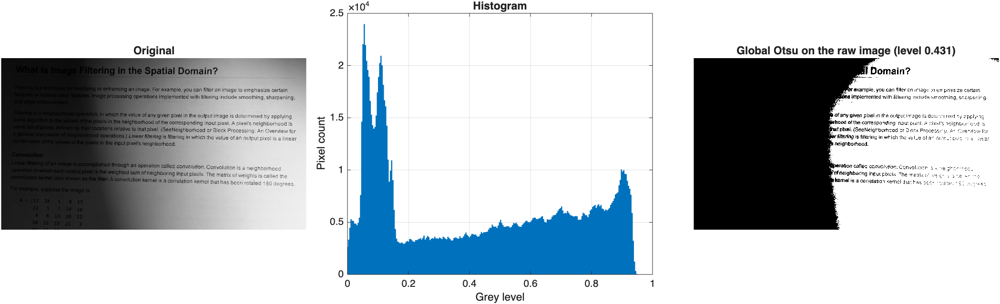
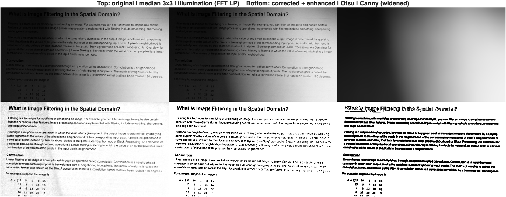
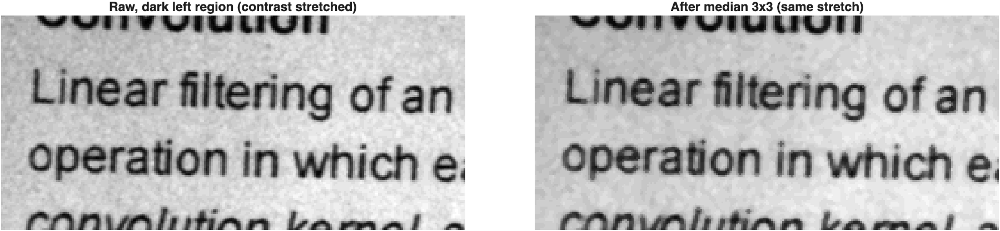
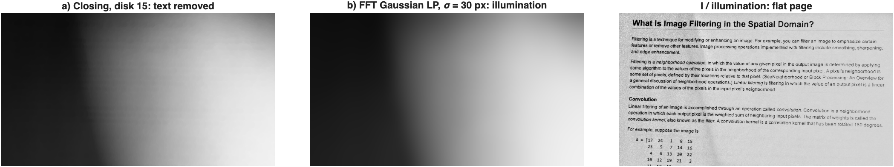
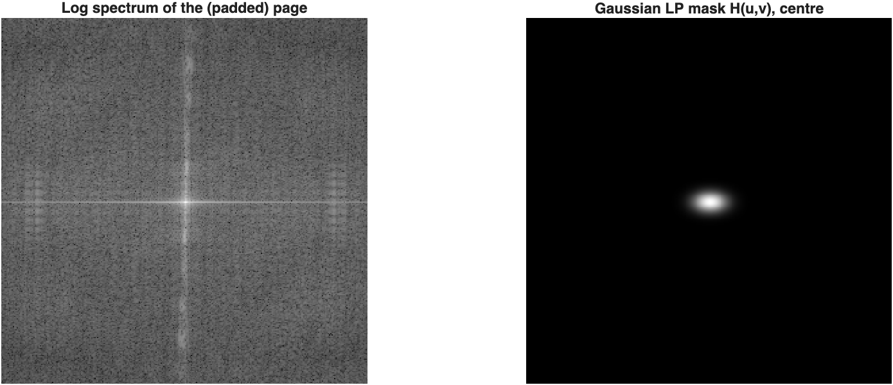
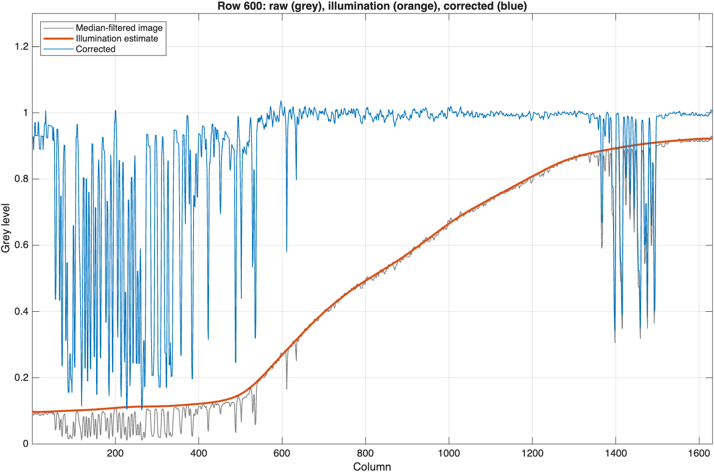
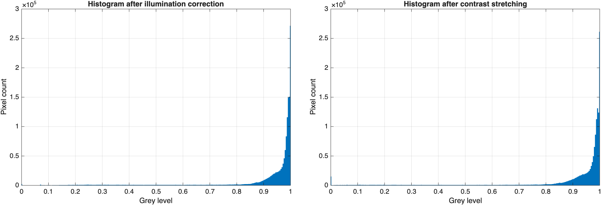
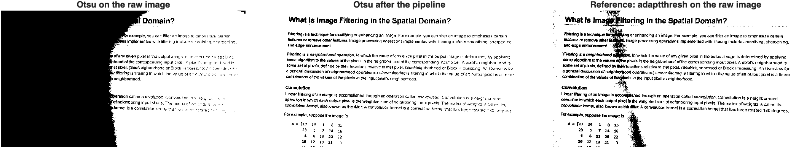
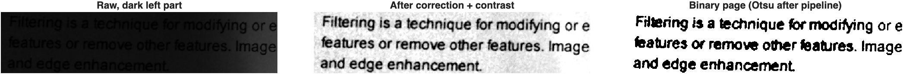
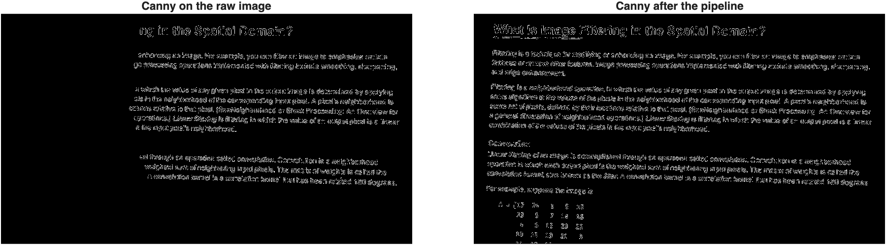

# Lecture 09: Mini Project – Reading a Page under Uneven Light (Lab 6)

This mini project combines the DSP concepts of the previous labs (filtering, frequency domain, enhancement, thresholding and edges) into one pipeline that solves a concrete problem.

---

## Problem

`printedtext.png` (a MATLAB sample image, 918 × 1632, not included) is a photo of a printed page under strongly uneven light. The left side is almost in darkness and the right side is brightly lit:

| Part of the page | Mean brightness |
|---|---|
| Left third | 0.090 |
| Middle third | 0.433 |
| Right third | 0.774 |

**Goal:** make the text readable everywhere on the page and produce a clean black-and-white page that an OCR program could read.



The naive approach, one global Otsu threshold, fails. The threshold 0.431 lies above the brightness of the dark paper and below the bright paper. As a result, the whole left third becomes black (100 % "ink") and the text there is lost. On the right, faint strokes fall above the threshold and letters break apart.

## Files

- [`Lecture09_lab6_mini_project.m`](Lecture09_lab6_mini_project.m): the pipeline. It prints all numbers below and saves every figure to `figures/`.
- `figures/`: the screenshots used below.

| Item | Value |
|---|---|
| MATLAB version | 26.2.0.3433840 (R2026b) Update 1 |
| Toolbox | Image Processing Toolbox |

```bash
cd Lecture09_Image_Processing_Labs/Lab6 && /Applications/MATLAB_R2026b.app/bin/matlab -batch "run('Lecture09_lab6_mini_project.m')"
```

---

## Pipeline



It follows the stages of the lab template, but each stage is chosen and tuned for this problem.

### 1) Pre-processing: 3×3 median filter



`medfilt2(I,[3 3],'symmetric')` removes isolated specks and single-pixel sensor noise before anything amplifies them. The page is clean enough that the filter leaves 60.9 % of the pixels unchanged and changes only 2.8 % by more than 5 grey levels. The zoom of the dark region (shown contrast-stretched) shows that the speckle in the paper becomes smoother, while the letters keep their shape.

**DSP view:** a non-linear (rank-order) filter. It removes impulse-like outliers without averaging across the letter edges (Lab 4).

### 2) Illumination estimate in the frequency domain



A photo of a page is the product $I = L \cdot R$ of the illumination $L$ and the paper/ink reflectance $R$. $L$ changes slowly across the page (low frequencies); the letters are small and sharp (high frequencies). So:

1. **Closing** (`imclose` with a disk of radius 15) removes the dark letters, which are thinner than the disk, and leaves the paper brightness.
2. **Gaussian low-pass in the frequency domain:** `fft2`, multiply by $H = e^{-2\pi^2\sigma^2 (f_x^2 + f_y^2)}$ with $\sigma = 30$ px, then `ifft2`. This smooths the remaining text traces and keeps only the slow illumination. $H$ drops to 0.5 at about 0.006 cycles/pixel, so only structures larger than a few hundred pixels pass.
3. **Division** $I / L$ cancels the illumination, because the model is multiplicative.



Before the FFT, the image is padded by mirroring it on all sides (90 px). The FFT treats an image as periodic. Without padding, the dark left edge would be blurred together with the bright right edge (Lab 3), and the estimate would be wrong near both borders. The mask looks elliptical only because the padded image is wider than tall, so the frequency samples are spaced differently along $u$ and $v$. In pixels, it is the same σ = 30 in both directions.



The profile along row 600 shows the effect.

- The illumination estimate (orange) follows the paper brightness from 0.1 on the left to 0.92 on the right, a ratio of **18.4 : 1** across the page.
- After division (blue), the paper lies at about 1.0 across the whole row, and the letters are dips below it.
- The variation of the paper brightness (std/mean of the paper pixels) drops from **0.660 to 0.056**.

**DSP view:** low-pass filtering in the frequency domain (the convolution theorem), padding to avoid circular wrap-around, and a multiplicative signal model handled by division.

### 3) Contrast enhancement



The template's fixed window `imadjust(...,[0.2 0.8])` does not suit a corrected page, because the paper now sits at 1.0 and would simply be clipped. `stretchlim` picks the window from the 1st and 99th percentiles instead: [0.156, 1.000]. After the correction, the histogram is already a narrow paper peak near 1 with a long, thin ink tail. The stretch only moves the darkest ink to 0, so this stage matters much less than the illumination correction.

**DSP view:** a linear point operation (amplitude remapping) chosen from the histogram (Lab 1).

### 4) Segmentation: Otsu on the corrected page




After correction, one global Otsu threshold works: level 0.612. Otsu's effectiveness measure rises from 0.820 to 0.846, which means the two classes (paper and ink) are better separated. Ink specks smaller than 5 px are removed afterwards with `bwareaopen`. For comparison, `adaptthresh` on the raw image (a local threshold) also recovers the dark side, but it leaves dark smears along the boundary of the shadow.

| Third | Ink % (Otsu raw) | Ink % (pipeline) | Ink % (`adaptthresh`) | Ink components (raw) | Ink components (pipeline) |
|---|---|---|---|---|---|
| Left | **100.0** | 12.7 | 19.2 | **1** | 371 |
| Middle | 47.9 | 8.3 | 11.6 | 374 | 375 |
| Right | 3.1 | 4.1 | 6.3 | 437 | 304 |

With the raw Otsu, the left third is one single black region. After the pipeline it holds 371 separate characters, about the same as the middle third. On the right, the raw threshold breaks faint letters into pieces: 437 components, which drops to 304 whole letters after correction. The left third has the most ink, because it contains the bold heading and the matrix of numbers.

**DSP view:** histogram-based automatic thresholding (Lab 5). It only works once the illumination has been removed and the histogram has two classes.

### 5) Features: Canny edges



Canny with the template's thresholds [0.1 0.25], before and after the pipeline:

| Third | Canny edge pixels (raw) | Canny edge pixels (pipeline) | Edges on bare paper (pipeline) |
|---|---|---|---|
| Left | 462 | 33290 | 1.9 % |
| Middle | 28458 | 28001 | 0.4 % |
| Right | 20923 | 19997 | 2.8 % |

On the raw image, the left third has almost no edges: in the dark, the gradients of the letters are too weak for the thresholds. After the pipeline, every character outline is found. Only 0.4–2.8 % of the edge pixels lie on bare paper, away from any ink. So the extra edges on the left are real letters, not amplified paper grain.

**DSP view:** gradient-based high-pass detection with smoothing, non-maximum suppression and hysteresis (Lab 5).

---

## Limitations and possible improvements

- **Noise amplification in the dark.** Dividing by an illumination of 0.05 multiplies everything there, including noise, by up to about 20. The zoom of the left part shows grainier paper than on the right. The median filter keeps this from creating false ink, but a darker photo would need stronger denoising first, for example non-local means.
- **Glare cannot be undone.** On the bright right side, the ink itself is washed out (grey, not black), and thin strokes are low in contrast. A few letters in the last lines ("rotated 180 degrees") still break up in the binary page. Division restores the paper level, not lost contrast.
- **Parameters are tuned for this page.** The closing disk (15 px) must be larger than the stroke width but smaller than the shadow features, and σ = 30 px must be slower than the text but fast enough to follow the shadow edge. A page with larger letters or sharper shadows would need different values. Making them depend on the estimated text size would make the pipeline more general.
- **No ground truth.** The quality figures (ink share, character counts, paper flatness, edges on paper) are indirect. A real evaluation would run OCR (`ocr` in the Computer Vision Toolbox) and measure character accuracy against the known text.
- **Possible improvements:** homomorphic filtering (a high-pass on $\log I$) as an alternative to division; deskewing the slightly tilted lines before OCR; using the corrected image with a locally adaptive threshold to recover the faint letters on the right.
