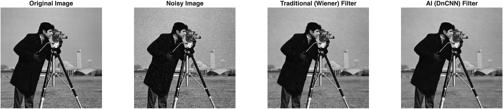
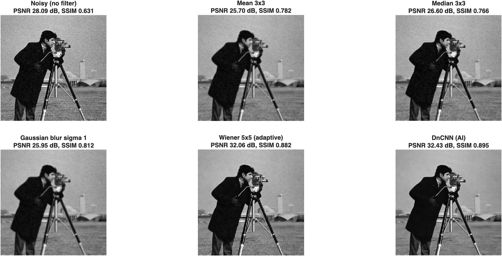
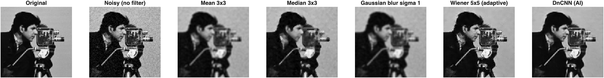
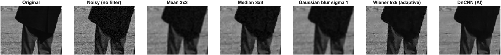
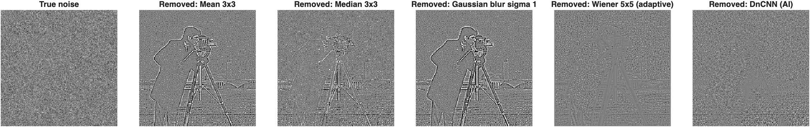
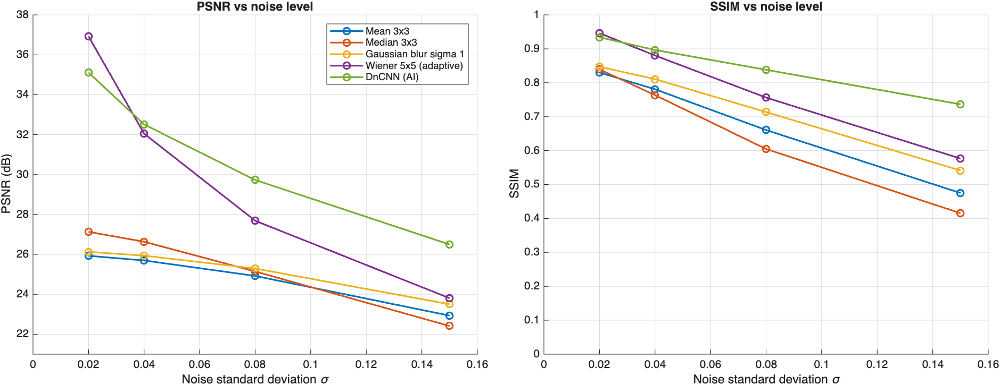

# Lecture 10: Traditional Filters vs AI Filters (Lab 7)

This lab adds Gaussian noise to an image and removes it with traditional filters (mean, median, Gaussian blur and the adaptive Wiener filter) and with a pre-trained denoising neural network (DnCNN). It compares the results with MSE, PSNR and SSIM.

---

## Files

- [`Lecture10_lab7_traditional_vs_ai.m`](Lecture10_lab7_traditional_vs_ai.m): the lab script. It saves every figure to `figures/`.
- `figures/`: the screenshots used below.

| Item | Value |
|---|---|
| MATLAB version | 26.2.0.3433840 (R2026b) Update 1 |
| Toolboxes | Image Processing Toolbox, Deep Learning Toolbox (pre-trained DnCNN) |
| Image | `cameraman.tif` (MATLAB sample image, not included), 256 × 256, `double` in [0, 1] |
| Noise | Gaussian, mean 0, σ = 0.04 (variance 0.0016) |

### Additions to the lab code

The lab's own code is unchanged. The script adds:

- **`rng(42)` before `imnoise`:** without a fixed seed, the noise and every number below would change on each run.
- **The mean, median and Gaussian-blur filters, and MSE:** both are named in the learning outcomes, but the lab code compares only Wiener and DnCNN, and only with PSNR and SSIM.
- **Run time per method**, measured with `timeit`.
- **Zoomed crops and residual maps** that show what each filter removed.
- **A sweep over four noise levels** (σ = 0.02 to 0.15).

## How to run

```bash
cd "Lecture10_Traditional Filter_vs_AI_Filters/Lab7" && /Applications/MATLAB_R2026b.app/bin/matlab -batch "run('Lecture10_lab7_traditional_vs_ai.m')"
```

---

## 1) Setup: Gaussian noise



`imnoise(I,'gaussian',0,0.04^2)` adds an independent random value with standard deviation 0.04 (about 10 grey levels) to every pixel. This is additive white Gaussian noise, the usual model for sensor noise. The noisy image has PSNR 28.09 dB and SSIM 0.6305. The noise is visible as fine grain, mostly in the flat sky.

## 2) Traditional filter: adaptive Wiener

`wiener2(I,[5 5],σ²)` estimates the local mean and variance in every 5×5 window. Where the local variance is close to the noise variance, the region is flat and the output moves towards the local mean (strong smoothing). Where the local variance is much larger, there is an edge or detail, and the pixel is mostly kept. Here it is given the true noise variance, which is an advantage a real application usually does not have.

## 3) AI filter: DnCNN

DnCNN is a convolutional network trained to predict the noise in a noisy image. The output is the input minus that prediction (residual learning). `denoiseImage` needs no information about the noise level: the network has learned it from training data.

## 4) Quantitative evaluation

The lab's own output:

```
Method                | PSNR (dB) | SSIM
Noisy Image           |  28.0900  |  0.6305
Traditional (Wiener)  |  32.0593  |  0.8820
AI (DnCNN)            |  32.4258  |  0.8948
```

All methods at σ = 0.04:

| Method | MSE | PSNR (dB) | SSIM | Time (ms) |
|---|---|---|---|---|
| Noisy (no filter) | 0.001552 | 28.09 | 0.6305 | — |
| Mean 3×3 | 0.002690 | 25.70 | 0.7824 | 0.4 |
| Median 3×3 | 0.002189 | 26.60 | 0.7656 | 3.1 |
| Gaussian blur σ = 1 | 0.002544 | 25.95 | 0.8119 | 1.0 |
| Wiener 5×5 (adaptive) | 0.000622 | 32.06 | 0.8820 | 1.9 |
| **DnCNN (AI)** | **0.000572** | **32.43** | **0.8948** | 151.5 |



- **MSE** is the mean squared difference from the original. **PSNR** $= 10\log_{10}(1/\text{MSE})$ expresses it in dB (higher is better). **SSIM** compares local brightness, contrast and structure, and is closer to how the eye judges an image (1 = identical).
- **The simple filters make PSNR *worse* at this noise level.** Mean, median and Gaussian blur all lower it, from 28.09 dB to 25.7–26.6 dB. The noise is weak, so the error they add by blurring edges and texture is larger than the noise they remove. Their SSIM still rises (to 0.77–0.81), because they make flat regions smoother. The two metrics disagree here, which is why both are reported.
- **Wiener and DnCNN** both improve PSNR by about 4 dB and SSIM to 0.88–0.89. DnCNN is ahead, but only by 0.37 dB and 0.013 SSIM.
- **Cost:** on the CPU, DnCNN takes about 150 ms for this small image, about 80 times longer than Wiener (1.9 ms).

### What each filter removed




- **Face and camera:** mean and Gaussian blur soften every edge, and the median is a little sharper. Wiener keeps the edges but leaves visible grain. DnCNN gives the cleanest result, with smooth flat areas and sharp outlines.
- **Grass:** DnCNN removes the noise **together with most of the grass texture**, so the field looks flat and smooth. Wiener keeps more of the real texture, but also some noise. The network cannot tell random grass texture from random noise, and treats both as noise.



The residual (noisy minus filtered) should ideally be pure noise, like the left panel. The outline of the cameraman in the mean and Gaussian residuals shows that these filters also removed image detail.

| Method | corr(removed, true noise) | corr(\|error\|, edge strength) |
|---|---|---|
| Mean 3×3 | 0.558 | 0.643 |
| Median 3×3 | 0.590 | 0.297 |
| Gaussian blur σ = 1 | 0.547 | 0.646 |
| Wiener 5×5 | 0.775 | 0.316 |
| DnCNN | **0.806** | 0.336 |

- **First column:** what DnCNN removes is the closest to the true noise (0.806).
- **Second column:** the error of the mean and Gaussian filters follows the image edges (0.64): they blur edges. The adaptive and non-linear methods keep their error much less tied to edges (0.30–0.34).

## 5) Noise-level sweep



| σ | Noisy PSNR | Mean | Median | Gaussian | Wiener | DnCNN |
|---|---|---|---|---|---|---|
| 0.02 | 34.00 | 25.93 | 27.13 | 26.13 | **36.92** | 35.11 |
| 0.04 | 28.07 | 25.70 | 26.63 | 25.94 | 32.05 | **32.51** |
| 0.08 | 22.28 | 24.92 | 25.15 | 25.29 | 27.69 | **29.73** |
| 0.15 | 17.01 | 22.93 | 22.41 | 23.50 | 23.81 | **26.50** |

(PSNR in dB. Each noise level uses its own random seed, so the σ = 0.04 row differs slightly from the table above.)

- **Low noise (σ = 0.02):** Wiener beats DnCNN by 1.8 dB, and the simple filters are far worse than doing nothing.
- **From σ = 0.04 up:** DnCNN wins, and its lead grows with the noise. At σ = 0.15 it is 2.7 dB ahead of Wiener, with SSIM 0.736 against 0.577.
- **The simple filters** only beat the noisy image from σ ≈ 0.08 upwards, when the noise is stronger than the detail they blur away.

---

## Visual observation and conclusion

**The lab's statement mostly holds, but with limits. DnCNN gives the best PSNR and SSIM from σ = 0.04 upwards and the cleanest-looking image. It does not preserve fine random texture, and at low noise the adaptive Wiener filter is better.**

- **For which task each filter is suited:**
  - mean and Gaussian blur only for strong noise, when blurring is acceptable;
  - the median for impulse noise (Lab 4), not for Gaussian noise;
  - Wiener for weak to moderate Gaussian noise with a known level: fast and close to DnCNN;
  - DnCNN for moderate to strong noise and when the noise level is unknown.
- **Where DnCNN wins:** it has learned what natural image structures look like, so it removes noise in flat regions almost completely and still keeps edges sharp.
- **Where it loses or costs more:**
  - it smooths away fine random texture such as the grass;
  - it is about 80 times slower on the CPU;
  - it needs the Deep Learning Toolbox and a trained model;
  - it only works well for the kind of noise it was trained on.
- **Fairness of the comparison:** the Wiener filter was given the exact noise variance, and a single image with one noise realisation per level is a small test.
