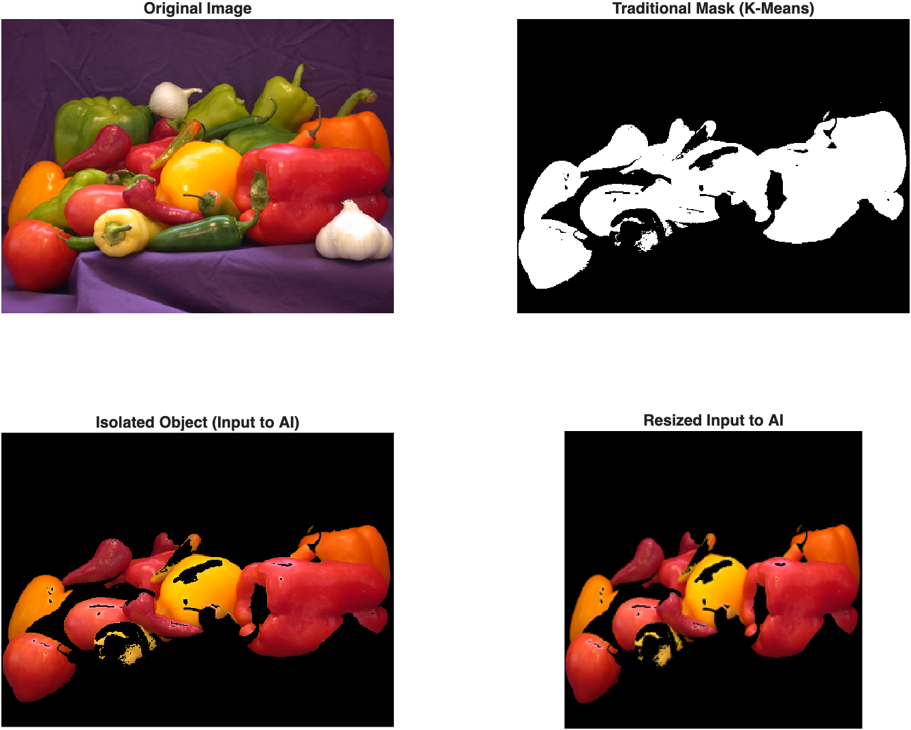
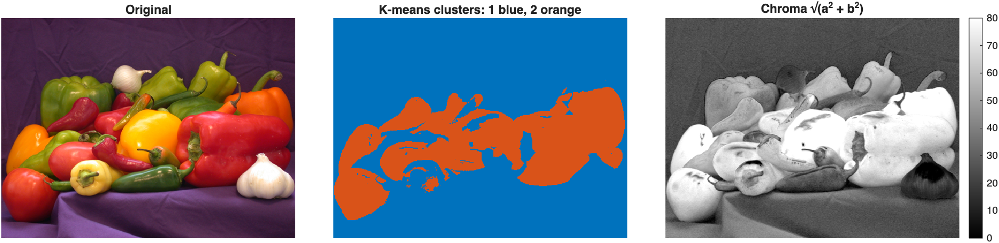
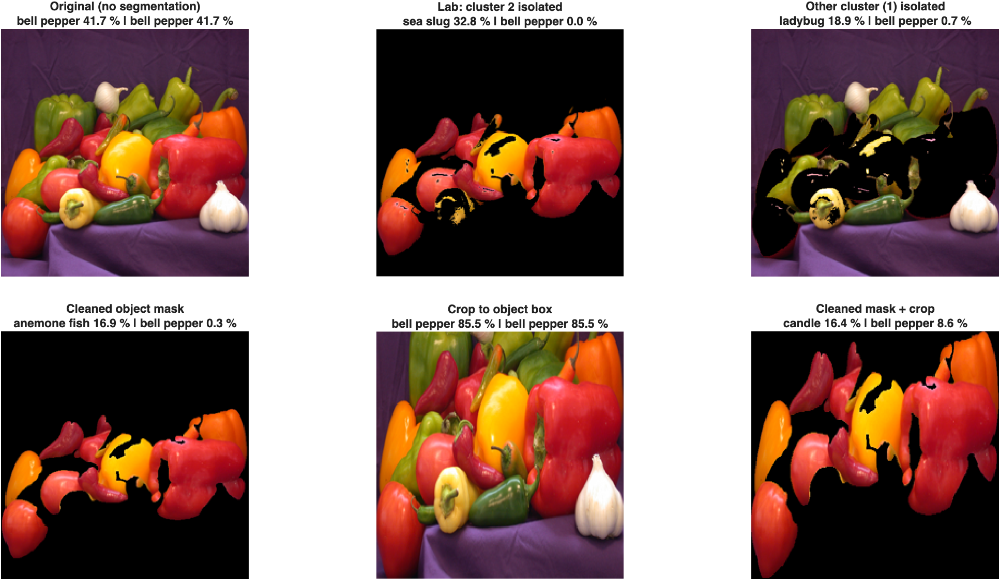
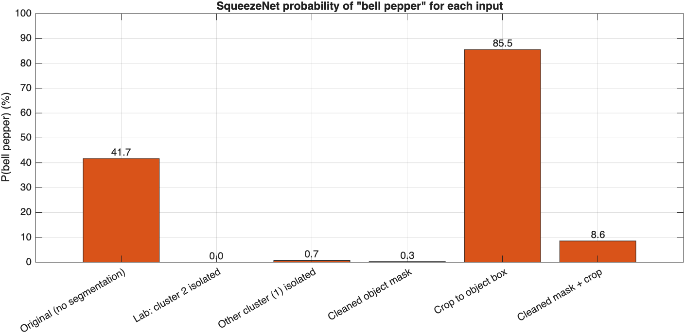

# Lecture 10: Hybrid Traditional + AI Pipeline (Lab 8)

This lab combines a traditional method with an AI method. K-means colour segmentation (traditional) isolates the object, and a pre-trained CNN, SqueezeNet (AI), classifies it. The lab's claim is that isolating the object first helps the classifier. This report tests that claim, and the result depends strongly on **how** the segmentation is used.

---

## Files

- [`Lecture10_lab8_hybrid_pipeline.m`](Lecture10_lab8_hybrid_pipeline.m): the lab script. It saves every figure to `figures/`.
- `figures/`: the screenshots used below.

| Item | Value |
|---|---|
| MATLAB version | 26.2.0.3433840 (R2026b) Update 1 |
| Toolboxes | Image Processing Toolbox, Deep Learning Toolbox + Deep Learning Toolbox Model for SqueezeNet Network |
| Image | `peppers.png` (MATLAB sample image, not included), 384 × 512 RGB |
| Network | SqueezeNet, trained on ImageNet (1000 classes, input 227 × 227 × 3) |

### Additions to the lab code

The lab's own code is unchanged. The script adds:

- **`rng(42)` before `imsegkmeans`:** k-means starts from random centres.
- **A check which cluster is really the object:** the lab assumes cluster 2.
- **The top-5 classes for six different inputs**, so that the effect of each way of using the segmentation is visible.
- **A k-means stability check** with five different seeds.

The lab's comments speak of a "flower", but the image is `peppers.png`, so the expected class is **bell pepper**, one of the ImageNet classes.

## How to run

```bash
cd "Lecture10_Traditional Filter_vs_AI_Filters/Lab8" && /Applications/MATLAB_R2026b.app/bin/matlab -batch "run('Lecture10_lab8_hybrid_pipeline.m')"
```

---

## Section 1: Image and AI network



`squeezenet` loads a small CNN (about 1.2 million parameters) that is pre-trained on ImageNet. It outputs a probability for each of 1000 classes. It is the AI component: it has learned what objects look like from about a million labelled photos.

## Section 2: Traditional method, K-means colour segmentation



The image is converted to L\*a\*b\*, and only the colour channels a\* and b\* (without lightness) are clustered into 2 groups with `imsegkmeans`.

| Cluster | Share of pixels | Mean chroma $\sqrt{a^2+b^2}$ | Mean lightness |
|---|---|---|---|
| 1 | 72.9 % | 29.1 | 30.7 |
| 2 | 27.1 % | **69.7** | 48.1 |

Cluster 2 is the strongly coloured one, so the lab's assumption "the object is cluster 2" holds here. It held for all five seeds tried, but k-means does not guarantee the numbering, so a robust pipeline should choose the cluster by a property such as chroma, as the script does.

The more important point is **what** the clusters separate. In colour space, k-means splits **warm colours (red, orange, yellow)** from **everything else**, not peppers from background. The green peppers, the green chili, the white garlic and the purple cloth all end up in cluster 1. Highlights on the yellow pepper also drop out, leaving holes. The "isolated object" is therefore a set of red and orange fragments, not the whole object.

## Section 3: AI classification of the isolated object

The masked image (background set to black) is resized to 227 × 227 and classified. **Lab result: "sea slug", 32.84 %.**

## Section 4: Results analysis




The same network was given six different inputs:

| Input to SqueezeNet | Top-1 class | Top-1 % | P(bell pepper) % |
|---|---|---|---|
| Original image (AI only, no segmentation) | bell pepper | 41.72 | 41.72 |
| **Lab: cluster 2 on black** | sea slug | 32.84 | **0.01** |
| Other cluster (1) on black | ladybug | 18.90 | 0.68 |
| Cleaned object mask on black | anemone fish | 16.87 | 0.26 |
| **Crop to the object's bounding box** | **bell pepper** | **85.52** | **85.52** |
| Cleaned mask + crop | candle | 16.36 | 8.55 |

The top-5 lists show what the network sees:

- **Original:** bell pepper 41.7 %, cucumber 39.6 %, Granny Smith 5.7 % (green apple). It is uncertain between vegetables, because the scene contains many objects and a large cloth background.
- **Lab's masked input:** sea slug 32.8 %, piggy bank 25.0 %, jack-o'-lantern 23.5 %, flatworm 11.6 %. All four are smooth, brightly coloured shapes on a dark background, and none is a vegetable.
- **Cropped input:** bell pepper 85.5 %, cucumber 12.8 %. The network is now confident and correct.

**Black-background masking makes the classification much worse:** P(bell pepper) drops from 41.7 % to 0.01 %. The reasons:

1. **The mask is not the object.** K-means separated warm colours, not peppers. The green peppers are cut away, and the remaining pieces have holes and ragged edges.
2. **The input no longer looks like a photo.** SqueezeNet learned from natural ImageNet photos. Bright fragments on pure black resemble the photos it saw of sea slugs, clownfish or jack-o'-lanterns, all bright objects in front of dark water or a dark night. The image is out of distribution for the network.
3. **Context helps.** The network recognises a bell pepper partly from its texture, highlights and stem, and from neighbouring vegetables. Masking removes much of that.

**Cropping with the same segmentation doubles the confidence.** The cleaned mask gives a bounding box that covers the vegetables (59.7 % of the image area). Cropping to it removes most of the purple cloth but keeps the photo natural. The objects become larger in the 227 × 227 input, and the irrelevant background no longer competes. P(bell pepper) rises from **41.7 % to 85.5 %**.

---

## Conclusion: does the hybrid pipeline improve the result?

**Yes, but only if the traditional step prepares the input in a way that suits the network. In this lab's version (masking to black) it made the result worse; used as a localiser (crop) it doubled the confidence.**

- **The traditional step** is cheap, needs no training, and is explainable: it answers *where* the object is (colour clustering, morphological cleaning, bounding box).
- **The AI step** answers *what* the object is, which hand-made rules cannot do across 1000 classes.
- **The interface between them matters.**
  - The CNN expects natural images. Cutting objects out onto black creates inputs it never saw in training.
  - A crop (or a region proposal) keeps the input natural and only removes distraction. Real hybrid systems work this way: object detectors classify cropped regions, not masked silhouettes.
- **Limitations:**
  - One image is not a benchmark. One crop improved one prediction here.
  - Two k-means clusters on colour only cannot isolate objects of several different colours. A better traditional step would cluster on more features (colour plus position or texture), use more clusters, or use graph-based segmentation.
  - `classify` and `squeezenet` are older Deep Learning Toolbox interfaces. Newer MATLAB code uses `imagePretrainedNetwork` and `minibatchpredict`, which do the same thing here.
