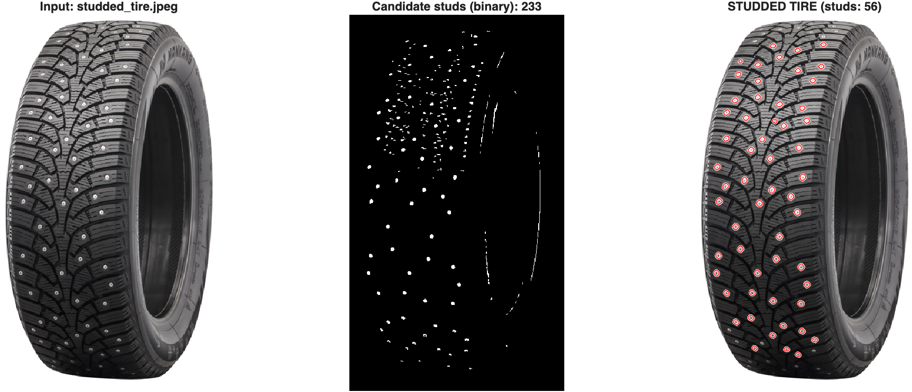
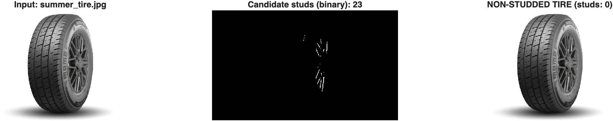
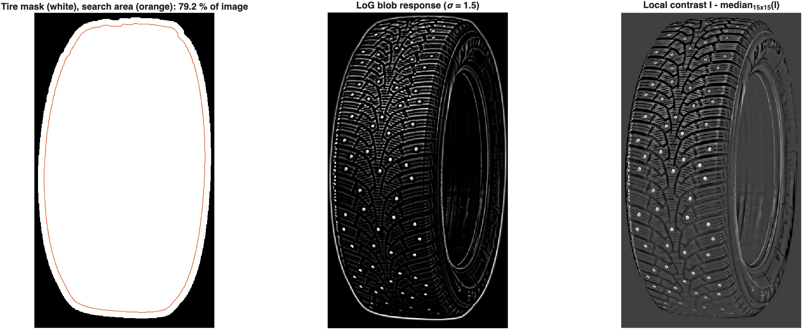
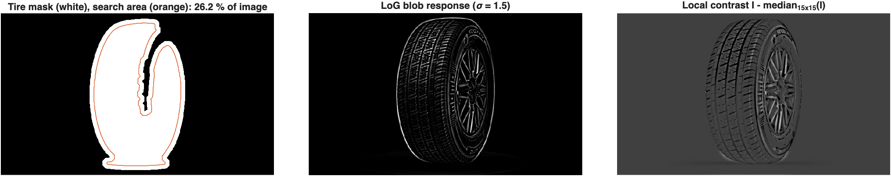

# Lecture 11: Tire Stud Detector (Lab 9)

A MATLAB script that detects metal studs on tires with image preprocessing and connected-component analysis, and classifies each tire as **STUDDED** or **NON-STUDDED**.

---

## Files

- [`tire_stud_detector.m`](tire_stud_detector.m): the detector, built on the course skeleton with every TODO filled in. It saves every figure to `figures/`.
- `studded_tire.jpeg`, `summer_tire.jpg`: the two input images. The studded image is a `.jpeg` file, so the script uses that name instead of the skeleton's `studded_tire.jpg`.
- `figures/`: the screenshots used below.

| Item | Value |
|---|---|
| MATLAB version | 26.2.0.3433840 (R2026b) Update 1 |
| Toolbox | Image Processing Toolbox |

```bash
cd Lecture11_Image_signals_Preporocessing/Lab9 && /Applications/MATLAB_R2026b.app/bin/matlab -batch "run('tire_stud_detector.m')"
```

## Result

| Image | Size (after resize) | Tire area (px) | Candidates | Studs | Studs per 10⁴ tire px | Decision |
|---|---|---|---|---|---|---|
| `studded_tire.jpeg` | 342 × 600 | 162 445 | 233 | **56** | 3.45 | **STUDDED TIRE** |
| `summer_tire.jpg` | 720 × 428 | 80 753 | 23 | **0** | 0.00 | **NON-STUDDED TIRE** |

Both tires are classified correctly, with a wide margin: 56 studs against 0, and a decision threshold of 10.




Each figure shows the three required panels: the original image, the binary candidate mask, and the final detection, with the detected studs outlined and the decision in the title.

---

## Pipeline (skeleton steps)

### 1) Read & resize

Each image is resized to 0.5. A stud then covers about 4–5 pixels across, which is enough for the shape tests and keeps the filters fast.

### 2) Grayscale

`rgb2gray` when the image is RGB, then `im2double` (values in [0, 1]). Studs differ from rubber in brightness, not in colour, so grayscale loses nothing.

### 3) Tire mask




The background is near-white and the tire is dark, so `Igray < 0.60` selects the tire. The mask is then cleaned:

- `imfill(...,'holes')` adds the bright details inside it: lit tread blocks, and the rim of the summer tire.
- An opening with a disk of radius 15 removes thin fringes.
- `bwareafilt(...,1)` keeps only the largest object.

Studs are searched only in the mask **shrunk by 12 px** (orange outline). The rounded shoulder of a tire reflects light along its outline, which would otherwise give a chain of false "studs" along the left edge of the studded tire.

The threshold matters. A first version used 0.45, and the lit upper part of the studded tread fell out of the mask in stripes, so the studs there were never searched. On the summer tire, that mask covered only 16.7 % of the image instead of the whole tire. A result of "0 studs" from such a mask would prove little.

### 4) Candidate studs

Studs are small, round, bright points inside the tire. A plain brightness threshold does not work here:

- In the bottom half of the studded image, the studs are grey-white (about 0.6–0.75), as bright as the light highlights on the rubber edges in the upper half.
- The summer tire has light text and a grey alloy rim.

Two features are combined instead:

- **Blob response (Laplacian of Gaussian, σ = 1.5 px):** a Gaussian smoothing followed by a second derivative, scaled by σ². It responds strongly to a round bright spot of about the stud's size (about 4 px across) and much more weakly to thin lines and edges. Its Gaussian part is the smoothing step the task asks for: it suppresses JPEG noise.
- **Local contrast:** $I - \text{median}_{15\times15}(I)$, the brightness above the rubber around the point. A metal stud is far brighter than the rubber around it. A highlight on a tread edge is only slightly brighter than the rubber next to it.

`cand = (blob > 0.08) & (localContrast > 0.20) & searchMask`, followed by `bwareaopen(cand,3)` to remove 1–2 px noise and `imfill(...,'holes')`. The contrast test is applied per pixel, so a stud does not merge with a neighbouring highlight into one large component that the shape filter would then reject.

### 5) Connected components

`bwconncomp` and `regionprops` with `Area`, `Perimeter`, `Eccentricity` and `MaxIntensity`. `MaxIntensity` is measured on the local-contrast image, so it gives each component's strongest contrast.

### 6) Filters

A component counts as a stud only if all of these hold:

| Test | Limit | Rejects |
|---|---|---|
| Area | 4–120 px | single-pixel noise, large bright patches |
| Circularity $4\pi A / P^2$ | ≥ 0.6 | ragged shapes |
| Eccentricity | ≤ 0.85 | elongated highlights, rim spokes, letters |
| Peak local contrast | ≥ 0.35 | grey highlights on rubber |

On the summer tire, all 23 candidates (reflections on the rim spokes and some tread edges) are long and thin, and all fail the shape tests. On the studded tire, 56 of 233 candidates pass.

### 7) Decision rule

`isStudded = studCount > 10`. The script also prints the density (studs per 10 000 tire pixels: 3.45 vs 0.00), which would be the better rule for images of different sizes or distances.

---

## Limitations

- **The stud count is a lower bound.** All 56 detections are real studs, apart from at most one small highlight. But many of the smaller, greyer studs are missed, mainly in the top rows, which are farther away and appear smaller, and in the bottom rows. At scale 0.5 they cover only 2–3 pixels, or their contrast is below 0.35. Using the full resolution found only a few more studs and added false detections on highlights. For a yes/no decision the margin is still large (56 vs 0).
- **The parameters are tuned for these two images.** They are the mask threshold, the 12 px margin, the stud size behind σ, the contrast thresholds and the decision threshold of 10. Another photo with a different distance, light or background (not white) would need new values. A more robust version would estimate the stud size from the tire size, and use a multi-scale blob detector.
- **Two test images are not a validation.** A wet or dirty tire, light lettering on the tread, or a studded tire with worn, dull studs could fool the bright-spot model. A proper evaluation needs a labelled set of tire photos and per-stud ground truth.
