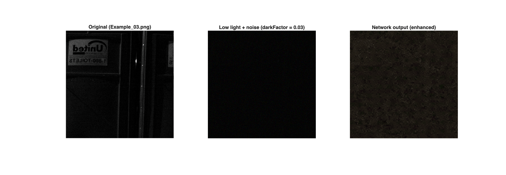
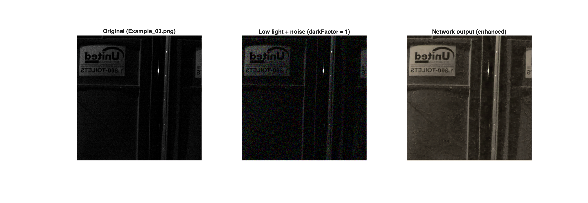
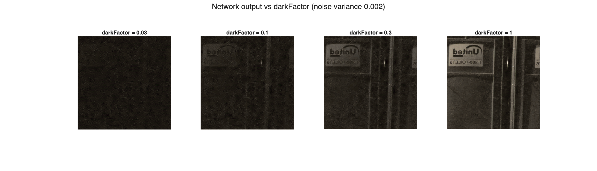

# Lecture 12: Learning to See in the Dark (Lab 10)

The course demo of the pretrained *Learning to See in the Dark* low-light enhancement network, run on our own dark image with one change to the process.

---

## Files

- [`Lecture12_lab10_low_light.m`](Lecture12_lab10_low_light.m): the code. This is the course demo with `imread("peppers.png")` replaced by our image and with one change (`darkFactor`, see below). The network steps 1–9 are unchanged.
- [`Example_03.png`](Example_03.png): **input image**, the dark photo supplied with the lab (331 × 331; resized to 512 × 512 by the script).
- [`Example_03_enhanced.png`](Example_03_enhanced.png): **enhanced result** at full 512 × 512 resolution.
- `figures/`: the figures used below.

| Item | Value |
|---|---|
| MATLAB version | 26.2.0.3433840 (R2026b) Update 1 |
| Toolboxes | Deep Learning Toolbox, Image Processing Toolbox |
| Model | `trainedLowLightCameraPipelineNet.mat` (≈ 22 MB, downloaded once to `tempdir/Sony2025`) |
| Run on | CPU (no GPU) |

```bash
cd Lecture12_Low_Light_Image_Enhancement/Lab10 && /Applications/MATLAB_R2026b.app/bin/matlab -batch "run('Lecture12_lab10_low_light.m')"
```

---

## Steps 1–3: model, edited script, run

1. **Own dark image.** `Example_03.png` (supplied with the lab) is in the script's folder.
2. **Edited script.** The image line now reads

   ```matlab
   % I = imread("peppers.png");                       % lab default
   I = imread(fullfile(scriptDir, "Example_03.png")); % our dark image
   ```

   `fullfile(scriptDir, …)` finds the image wherever MATLAB is started from.
3. **Run.** On the first run the script downloaded the pretrained model ("Downloading pretrained low-light model… Download complete"). It then enhanced the image and showed original → dark/noisy → enhanced.

---

## Step 4: our change: `darkFactor = 0.03` → `darkFactor = 1`

```matlab
darkFactor = 1;   % was 0.03: do not darken a photo that is already dark
```

**Why.** The demo was written for `peppers.png`, a normally lit image. It multiplies the image by `darkFactor = 0.03` to *simulate* low light. `Example_03.png` is already a real low-light photo, with a mean brightness of only **0.046** (on a 0–1 scale). Multiplying it by 0.03 again leaves a signal of about **0.0014**, which is 0.35 of one grey level out of 255. The added Gaussian noise has a standard deviation of $\sqrt{0.002} = 0.045$, about **30 times** larger. Almost no scene information is left, and no network can recover what is no longer in its input.

With `darkFactor = 1` the real dark photo goes into the network unchanged, plus the same noise (variance 0.002). This is the actual use case of the model: enhancing a photo that was taken in the dark.

### Lab default (`darkFactor = 0.03`)



The darkened input is black, and the network output is a brown, noisy texture with no visible scene. The network turned the noise into "something", but there is no sign, no door and no light in it.

### Our change (`darkFactor = 1`)



The enhanced image is about **4 times brighter** than the input (mean 0.202 compared with 0.046). The mirrored *United / 1-800-TOILETS* sign, the door frames, the diagonal brace on the left door and the lights on the pole are all clearly visible. The network also suppressed most of the added noise. Flat areas show a light grain instead of the speckle in the middle panel, and no pixel is clipped to white.

### Supporting evidence: sweep over `darkFactor`



Same image, same noise (`rng(42)`), only `darkFactor` changes:

| `darkFactor` | Signal left (mean, before noise) | Network input mean* | Output mean | Output std (contrast) | What is visible |
|---|---|---|---|---|---|
| 0.03 (lab default) | 0.0014 | 0.0185 | 0.086 | 0.023 | nothing, only noise texture |
| 0.1 | 0.0046 | 0.0204 | 0.106 | 0.035 | faint outline of the sign |
| 0.3 | 0.014 | 0.0269 | 0.142 | 0.061 | sign readable, door frames |
| **1 (our change)** | **0.046** | **0.0543** | **0.202** | **0.112** | **whole scene, sharpest** |

\* `imnoise` clips the result to [0, 1], so negative noise samples become 0. For a nearly black image this adds a positive bias of about 0.018, so at `darkFactor = 0.03` the network input is almost entirely noise.

Output brightness and contrast (std) rise steadily with `darkFactor`. Contrast grows almost 5× from 0.03 to 1. The image only becomes usable from about 0.3 upwards, so for a photo that is already dark the right choice is not to darken it further.

---

## Summary

- **Input:** [`Example_03.png`](Example_03.png), a real low-light photo (mean brightness 0.046).
- **Enhanced result:** [`Example_03_enhanced.png`](Example_03_enhanced.png) (mean brightness 0.202, with the noise reduced).
- **Change:** `darkFactor` 0.03 → 1. The demo's extra darkening is meant for normally lit images. On an image that is already dark it destroys the signal (0.35 grey levels under noise with std 0.045), and the network returns only noise texture. Without it, the network brightens and denoises the real dark photo and recovers the whole scene.

**Note on the input format.** The real SID network expects a 4-channel packed Bayer RAW image. The demo feeds it a grayscale image copied into 4 channels instead, so the network has no colour information. This explains the warm, sepia-like tint of the output: it is the network's average colour, not the scene's real colour.
