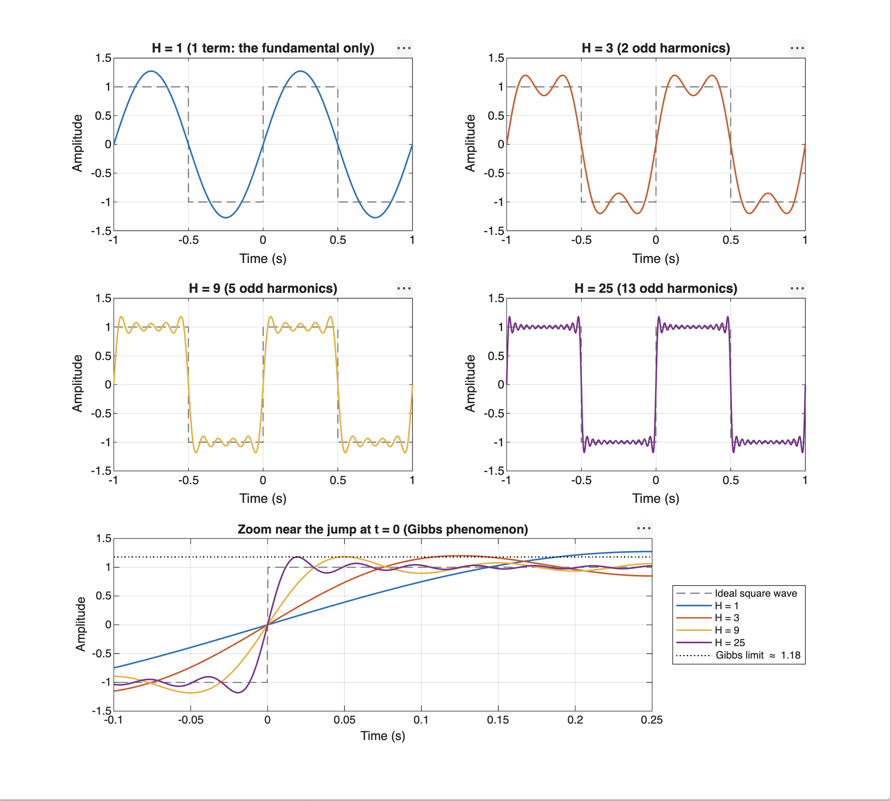
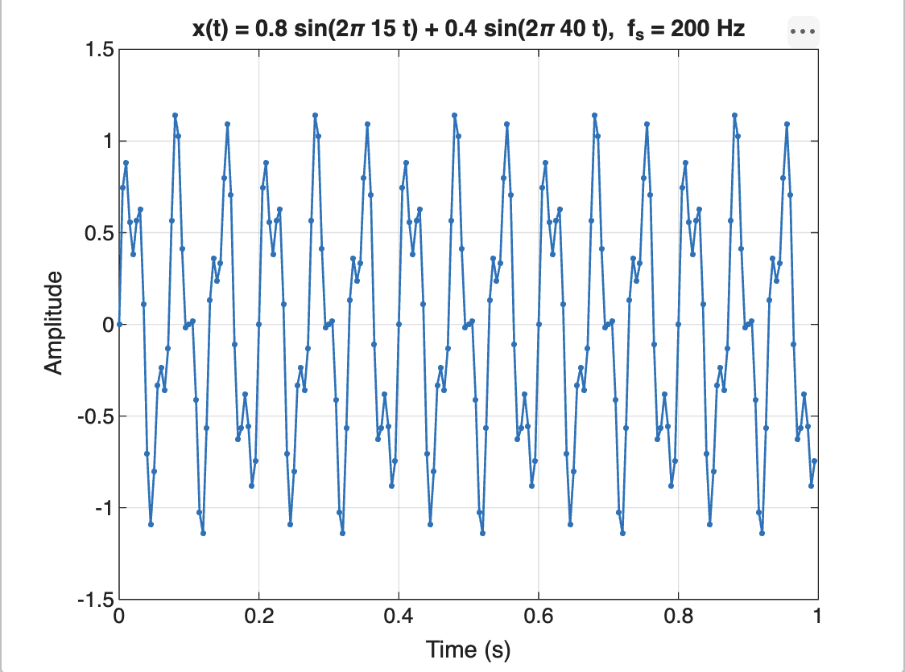
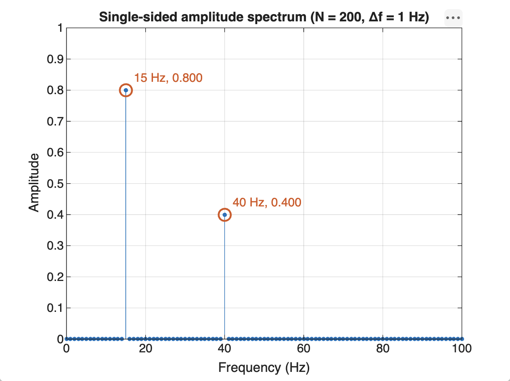
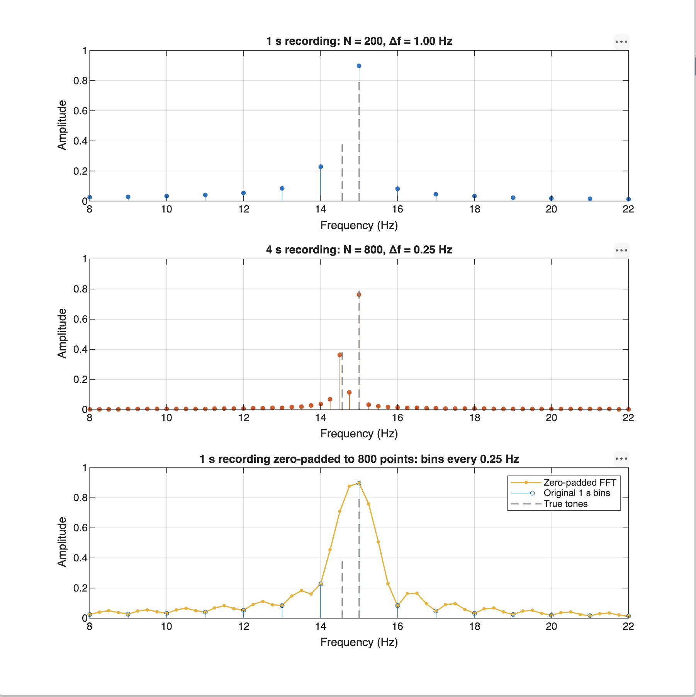

# Lecture 5: Fourier Series, DTFT and DFT

MATLAB exercises on how periodic signals are built from harmonics and how the DFT represents the frequencies of a sampled signal.

**Exercise 3 digit:** $d = 8$, so $f_2 = 13.2 + 0.17 \cdot 8 = 14.56$ Hz.

---

## Files

```
lecture-5-fourier-assignment/
├── README.md
├── exercise-1/
│   ├── exercise1.m
│   └── square-wave-comparison.png
├── exercise-2/
│   ├── exercise2.m
│   ├── two-frequency-time.png
│   └── two-frequency-spectrum.png
├── exercise-3/
│   ├── exercise3.m
│   └── leakage-comparison.png
└── exercise-4/
    ├── exercise4.m
    └── dtft-dft-comparison.png
```

## How to Run

Each script is self-contained and saves its PNGs next to itself. From the repository root:

```bash
cd exercise-1 && matlab -batch "run('exercise1.m')"
```

Do the same for `exercise-2` to `exercise-4`. No toolboxes are needed. Exercise 3 and Exercise 4 use local functions inside a script, which needs MATLAB R2016b or newer.

---

## Exercise 1: Build a Square Wave from Harmonics

The square wave with period 1 s and amplitude $\pm 1$ is approximated by its Fourier series, keeping only the odd harmonics up to $H$:

$$x_H(t) = \frac{4}{\pi} \sum_{\substack{k = 1 \\ k\ \text{odd}}}^{H} \frac{\sin(2\pi k t)}{k}$$

### Task 1: Prediction (before running MATLAB)
> **Prediction:** With $H = 1$ the result is a plain sine wave. Each new odd harmonic should make the edges steeper and the tops flatter, so the waveform should look more and more like a square wave. I expect some wiggles on the flat parts because a finite sum of smooth sines cannot jump instantly.

### Tasks 2–3: Plot


The top four panels show each approximation against the ideal square wave (dashed). The bottom panel overlays all four near the jump at $t = 0$.

| $H$ | Terms used | Peak value | Overshoot above 1 |
| :---: | :---: | :---: | :---: |
| 1 | 1 | 1.273 | 27.3% (this is just $4/\pi$, the amplitude of the sine) |
| 3 | 2 | 1.200 | 20.0% |
| 9 | 5 | 1.182 | 18.2% |
| 25 | 13 | 1.180 | 17.9% |

### Task 4: What changes as H increases?
> **Answer:** **The waveform gets closer to a square wave: steeper edges, flatter tops, and faster but smaller ripples.**
>
> - $H = 1$ is a single sine with amplitude $4/\pi \approx 1.27$. It has the right period but no flat parts.
> - Each added harmonic $k$ has amplitude $\frac{4}{\pi k}$, so higher harmonics add less and less. They add the fast detail the square wave needs at its edges.
> - The rise time at each jump gets shorter. For $H = 25$, the first peak after the jump at $t = 0$ is at $t \approx 0.019$ s, roughly $\frac{1}{2(H+1)}$.
> - The ripple on the flat parts gets faster, because the highest harmonic sets its frequency, and smaller away from the edges. In the middle of each half period the curve is already very close to $\pm 1$ for $H = 25$.

### Task 5: What happens near the sharp transitions?
> **Answer:** **The curve overshoots the square wave by about 9% of the jump, and the overshoot does not go away as H increases (the Gibbs phenomenon).**
>
> The jump goes from $-1$ to $+1$, a height of 2. Next to the jump the approximation rises to about $1.18$, which is $\approx 0.09 \times 2$ above the target. The table shows the peak dropping from 1.20 ($H = 3$) to 1.18 ($H = 9$) and then staying at 1.18 for $H = 25$. Adding more harmonics squeezes the overshoot into a narrower region closer to the jump, but it does not make it lower.
>
> This happens because each partial sum is a sum of smooth, continuous sines. It cannot follow an instant jump, so it overshoots and rings around it. The series still converges in energy: the area of the error shrinks as $H$ grows, because the overshoot gets narrower. Its height stays at about 9% for any finite $H$. Exactly at the jump the sum equals 0, the midpoint between $-1$ and $+1$.

---

## Exercise 2: Find Two Frequencies with the FFT

$$x(t) = 0.8\sin(2\pi \cdot 15\,t) + 0.4\sin(2\pi \cdot 40\,t), \qquad f_s = 200 \text{ Hz},\ T = 1 \text{ s}$$

### Task 1: Prediction (before running MATLAB)
> **Prediction:** The two frequencies are **15 Hz with amplitude 0.8** and **40 Hz with amplitude 0.4**. Both are below the Nyquist frequency $f_s/2 = 100$ Hz, and both complete a whole number of cycles in 1 s, so I expect two clean peaks with exactly these heights and nothing else in the spectrum.

### Task 2: Time domain


The slower 15 Hz wave carries most of the energy. The 40 Hz wave rides on top as a smaller, faster wiggle. The peaks reach about $\pm 1.14$, not $\pm 1.2$, because the two sines never reach their maxima at the same sample.

### Task 3: Single-sided amplitude spectrum


The spectrum is computed with the given pattern: `P2 = abs(Y/N)` takes the two-sided magnitude, and `P1(2:end-1) = 2*P1(2:end-1)` folds the negative frequencies onto the positive ones. A real sine of amplitude $A$ splits into $A/2$ at $+f$ and $A/2$ at $-f$, so doubling restores $A$. DC and Nyquist have no mirror bin, so they are not doubled.

### Task 4: Compare peaks with the values used to create the signal
> **Answer:** **Both peaks match exactly: 15 Hz at 0.800 and 40 Hz at 0.400. Every other bin is effectively zero (about $10^{-15}$).**
>
> | Peak | Expected frequency | Measured frequency | Expected amplitude | Measured amplitude |
> | :---: | :---: | :---: | :---: | :---: |
> | 1 | 15 Hz | 15 Hz | 0.8 | 0.800 |
> | 2 | 40 Hz | 40 Hz | 0.4 | 0.400 |
>
> The match is exact because both frequencies are whole multiples of the bin spacing (bins $k = 15$ and $k = 40$). Each sine completes a whole number of cycles in the recording, so it lines up with one DFT basis function and is zero for all the others. There is no leakage.

### Task 5: Frequency-bin spacing
> **Answer:** **$\Delta f = 1$ Hz.**
>
> $$N = f_s \cdot T = 200 \cdot 1 = 200 \text{ samples}$$
>
> $$\Delta f = \frac{f_s}{N} = \frac{200 \text{ Hz}}{200} = 1 \text{ Hz}$$
>
> This is the same as $1/T$: the bin spacing depends only on how long the recording is. The single-sided spectrum has $N/2 + 1 = 101$ bins, from 0 Hz to 100 Hz.

---

## Exercise 3: Investigate Spectral Leakage

$$d = 8 \quad\Rightarrow\quad f_2 = 13.2 + 0.17 \cdot 8 = 14.56 \text{ Hz}$$

$$x(t) = 0.8\sin(2\pi \cdot 15\,t) + 0.4\sin(2\pi \cdot 14.56\,t), \qquad f_s = 200 \text{ Hz}$$

$f_2$ completes 14.56 cycles in 1 s, which is not a whole number. It is also only 0.44 Hz away from the 15 Hz tone.

### Task 1: Prediction (before running MATLAB)
> **Prediction:** With 1 Hz bins, 14.56 Hz falls between the bins at 14 Hz and 15 Hz. The peak at $f_2$ should **leak**: its energy spreads over several neighbouring bins, so no bin shows the full 0.4, and small values appear far from 14.56 Hz. And because $f_2$ is less than one bin away from 15 Hz, I expect the two tones to **merge into one peak** that cannot be separated.

### Tasks 2, 3 and 5: Spectra


All three panels are zoomed to 8–22 Hz. The dashed gray lines mark the true tones (15 Hz at 0.8 and 14.56 Hz at 0.4).

Bins around the two tones:

| Frequency | 1 s ($\Delta f = 1$ Hz) | 4 s ($\Delta f = 0.25$ Hz) | 1 s zero-padded ×4 |
| :---: | :---: | :---: | :---: |
| 13.00 Hz | 0.085 | 0.014 | 0.085 |
| 14.00 Hz | **0.228** | 0.039 | **0.228** |
| 14.25 Hz | – | 0.070 | 0.457 |
| 14.50 Hz | – | **0.363** | 0.708 |
| 14.75 Hz | – | 0.115 | 0.877 |
| 15.00 Hz | **0.897** | **0.764** | **0.897** |
| 15.25 Hz | – | 0.032 | 0.759 |
| 16.00 Hz | 0.083 | 0.016 | 0.083 |
| 30.00 Hz (far away) | 0.0051 | 0.0018 | 0.0051 |

### Task 4: Compare the one-second and four-second spectra
> **Answer:** **The 1 s recording shows one merged peak with leakage. The 4 s recording has 4× finer bins (0.25 Hz), so the two tones show up as two separate peaks and the leakage is narrower.**
>
> **One second, $N = 200$, $\Delta f = 1$ Hz.** There is only one peak, at 15 Hz. It reads 0.897 instead of 0.8, because leakage from the 14.56 Hz tone adds into that bin. The second tone appears only as a shoulder of 0.228 at 14 Hz. Leakage is also visible as a slowly decaying tail on both sides, still about 0.005 at 30 Hz. The 15 Hz tone fits exactly 15 cycles, so on its own it would give a clean 0.8. All the spreading comes from $f_2$.
>
> **Four seconds, $N = 800$, $\Delta f = 200/800 = 0.25$ Hz.** There are now two peaks, 0.363 at 14.50 Hz and 0.764 at 15.00 Hz, with a dip to 0.115 at 14.75 Hz between them. The tones are 0.44 Hz apart, which is more than the new bin spacing, so they can be resolved. $f_2$ completes 58.24 cycles in 4 s, still not a whole number, so there is still some leakage. That is why the peaks read a little below 0.4 and 0.8. But each leaked peak is now 4× narrower in Hz, and the far-away leakage is lower (0.0018 at 30 Hz).
>
> In short, a longer recording gives smaller bin spacing ($\Delta f = 1/T$). The peak gets narrower, its position gets more accurate, and close frequencies can be separated.

### Task 5: Zero-padding with `fft(x, 4*length(x))`
> **Answer:** **The zero-padded plot looks smoother, with points every 0.25 Hz, but it still shows one merged peak. It contains no more information than the original 1 s recording.**
>
> Zero-padding adds 600 zeros to the end of the 200 real samples before the FFT. The FFT then samples the same underlying spectrum (the DTFT of the 200 samples) at 4× more points. In the plot:
>
> - The curve between the original bins is filled in, and the side lobes of the leakage pattern become visible (for example, small bumps at 12.5 Hz and 16.5 Hz).
> - At the original bin frequencies the values are **exactly the same** as the 1 s spectrum (0.228 at 14 Hz, 0.897 at 15 Hz), which shows that zero-padding only interpolates.
> - The main peak is still one wide hump around 15 Hz with no dip between 14.56 Hz and 15 Hz. The two tones are still not separated.
>
> Zero-padding gives finer *display* spacing, not finer *resolution*. Resolution is set by how long the signal was actually recorded, about $1/T = 1$ Hz here. Only the 4 s recording, with real new samples, could separate tones 0.44 Hz apart.
>
> Scaling note: the script divides the zero-padded FFT by the number of real samples (200), not by 800. Dividing by 800 would make every amplitude 4× too small, because the 600 zeros add no energy.

---

## Exercise 4: Compare the DTFT and DFT

$$x[n] = [1,\ 1,\ 1,\ 1], \quad n = 0, 1, 2, 3$$

$$X(e^{j\omega}) = \sum_{n=0}^{3} e^{-j\omega n} = e^{-j3\omega/2}\,\frac{\sin(2\omega)}{\sin(\omega/2)} \quad\Rightarrow\quad |X(e^{j\omega})| = \left|\frac{\sin(2\omega)}{\sin(\omega/2)}\right|$$

### Tasks 1–3: Plots
![DTFT of [1 1 1 1] with fft(x,4) and fft(x,64) on top](exercise-4/dtft-dft-comparison.png)

DFT bin $k$ sits at $\omega_k = 2\pi k / N$. Bins above $\pi$ are moved down by $2\pi$ so they line up with the DTFT plotted from $-\pi$ to $\pi$.

- `fft(x,4)` = $[4,\ 0,\ 0,\ 0]$
- `fft(x,64)` has exact zeros at $k = 16, 32, 48$

### Task 4: Compare the smooth DTFT curve with the DFT values
> **Answer:** **Every DFT value lies exactly on the DTFT curve. The DFT is the DTFT sampled at $N$ evenly spaced frequencies.**
>
> $$X[k] = X(e^{j\omega})\Big|_{\omega = 2\pi k/N}$$
>
> - **`fft(x,4)`** samples the DTFT at $\omega = 0, \pi/2, \pi, 3\pi/2$. It gives 4 at $\omega = 0$ and 0 at the other three points, because those three happen to be exactly the zeros of the DTFT. Seen alone, the 4-point DFT looks like a single spike and hides the main lobe and side lobes entirely.
> - **`fft(x,64)`** samples the same curve every $2\pi/64 \approx 0.098$ rad. The 64 points trace out the main lobe around 0 and the small side lobes, and they match the 1000-point DTFT.

### Task 5: Why does `fft(x,64)` produce more frequency points? Does it add new samples?
> **Answer:** **`fft(x,64)` pads x with 60 zeros to length 64, and an N-point DFT always returns N frequency points. It does not add any new samples of the signal.**
>
> The padded sequence $[1,1,1,1,0,0,\dots,0]$ has exactly the same DTFT as $[1,1,1,1]$, because the extra zeros add nothing to $\sum x[n] e^{-j\omega n}$. So `fft(x,64)` samples the same curve more densely ($2\pi/64$ instead of $2\pi/4$ apart). It makes the curve easier to see but gives no new information about the signal. This is the same effect as the zero-padding in Exercise 3.

### Task 6: Where does the DTFT magnitude become zero?
> **Answer:** **At $\omega = \pm\pi/2$ and $\omega = \pm\pi$ rad/sample.**
>
> The numerator $\sin(2\omega)$ is zero at $\omega = 0, \pm\pi/2, \pm\pi$. At $\omega = 0$ the denominator is also zero, and the limit is $N = 4$, the peak (the sum of all samples). So the zeros in $[-\pi, \pi]$ are at $\pm\pi/2$ and $\pm\pi$. These are the frequencies where the four unit phasors $e^{-j\omega n}$ point in directions that cancel. They match the zero bins of `fft(x,64)`: $k = 16, 32, 48$ correspond to $\omega = \pi/2,\ \pi,\ 3\pi/2 \equiv -\pi/2$.
>
> On the plot the curve reaches 0 exactly at $\pm\pi$. At $\pm\pi/2$ it dips to about 0.004, not exactly 0, because the 1000-point `linspace` grid does not land exactly on $\pi/2$.

---

## Use of AI Tools

I used an AI assistant (Claude Code) to help write the MATLAB scripts and to draft the explanations in this README. I ran each script myself in MATLAB, checked that the plots and printed values match the numbers above, and reviewed and edited the explanations.
